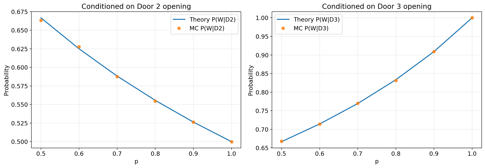

# Diffusion from First Principles - Milestones

This page is the portfolio index for the curriculum. It links the artifacts that are most useful to skim: mini-projects, visual notebooks, and derivation notes with a concrete implementation check.

## Completed Mini-Projects

| Milestone | Artifact | What it shows | What I learned |
| --- | --- | --- | --- |
| Checkpoint 01 - Conditioning in Code | [`mini_projects/checkpoint_01_conditioning_in_code/`](mini_projects/checkpoint_01_conditioning_in_code/) | Bayes' rule and conditioning verified with a biased Monty Hall Monte Carlo simulation. | Conditioning is not just filtering data after the fact. It changes the probability model by using the observed event as evidence. |
| Checkpoint 02 - Toy Score Matching | [`mini_projects/checkpoint_02_toy_score_matching/`](mini_projects/checkpoint_02_toy_score_matching/) | Two training objectives compared against the exact score of a noisy 2D Gaussian mixture. | A shared analytic reference makes objective comparisons meaningful; under the fixed runs, the converted $x_0$ predictor had lower validation score MSE than direct score prediction. |

## Best Current Artifacts

| Artifact | Type | Status | Why it matters |
| --- | --- | --- | --- |
| [`notes/w03_score_of_gaussian.md`](notes/w03_score_of_gaussian.md) + [`notebooks/w03_score_verification_solved.ipynb`](notebooks/w03_score_verification_solved.ipynb) | Derivation + notebook | Complete | Shows that the 1D Gaussian score is a simple pull back toward the mean. |
| [`notes/w04_conditioning_in_diffusion.md`](notes/w04_conditioning_in_diffusion.md) | Diffusion bridge note | Complete | Connects conditioning to denoising intuition before the diffusion-specific machinery appears. |
| [`notebooks/w05_joint_gaussians_solved.ipynb`](notebooks/w05_joint_gaussians_solved.ipynb) | Notebook | Complete | Shows that conditional slices of a joint Gaussian are Gaussian and can be checked empirically. |
| [`notes/w05_2d_gaussian_score.md`](notes/w05_2d_gaussian_score.md) + [`notebooks/w05_2d_gaussian_score_field_solved.ipynb`](notebooks/w05_2d_gaussian_score_field_solved.ipynb) | Derivation + notebook | Complete | Shows that a 2D score is a vector field shaped by the precision matrix. |
| [`notebooks/w06_kl_gaussians_solved.ipynb`](notebooks/w06_kl_gaussians_solved.ipynb) + [`notes/w06_where_kl_appears.md`](notes/w06_where_kl_appears.md) | Notebook + bridge note | Complete | Derives KL for 1D Gaussians, checks empirical estimates, and connects KL to distribution matching in diffusion/flow models. |
| [`notes/w07_conditional_expectation_in_diffusion.md`](notes/w07_conditional_expectation_in_diffusion.md) | Diffusion bridge note | Complete | Connects MSE-optimal denoising and conditional expectation to the Gaussian score identity. |
| [`notebooks/w09_pca_svd_solved.ipynb`](notebooks/w09_pca_svd_solved.ipynb) + [`notes/w09_linear_algebra_in_unets.md`](notes/w09_linear_algebra_in_unets.md) | Notebook + bridge note | Complete | Connects projection, eigendecomposition, SVD, low-rank reconstruction, and nonlinear latent representations. |
| [`notebooks/w10_mv_gaussian_score_solved.ipynb`](notebooks/w10_mv_gaussian_score_solved.ipynb) + [`proofs/w10_multivariate_gaussian_score.md`](proofs/w10_multivariate_gaussian_score.md) | Notebook + derivation | Complete | Checks Gaussian sampling, analytical scores, and conditional moments against numerical evidence. |
| [`notebooks/w11_minimal_vae_mnist_solved.ipynb`](notebooks/w11_minimal_vae_mnist_solved.ipynb) + [`notes/w11_why_latent_diffusion.md`](notes/w11_why_latent_diffusion.md) | Notebook + bridge note | Complete | Connects the ELBO to reconstruction, prior generation, and the limits of learned compression. |
| [`notebooks/w12_realnvp_2d_blobs_solved.ipynb`](notebooks/w12_realnvp_2d_blobs_solved.ipynb) + [`notes/w12_flows_vs_diffusion.md`](notes/w12_flows_vs_diffusion.md) | Notebook + comparison | Complete | Implements exact model likelihood and inverse sampling, with a one-layer architecture failure comparison. |
| [`notebooks/w13_optimizers_sanity_solved.ipynb`](notebooks/w13_optimizers_sanity_solved.ipynb) + [`notes/w13_training_stability_for_diffusion.md`](notes/w13_training_stability_for_diffusion.md) | Notebook + experiment report | Complete | Checks GD, momentum, and Adam, then shows that bounded gradients did not improve held-out score accuracy in one matched clipping experiment. |
| [Checkpoint 03 study report](mini_projects/checkpoint_03_generative_toolkit_report/report.md) + [final review](notes/w14_study_plan.md#day-7-completion-decision) | Comparison report + checkpoint review | Study complete 2026-10-27 | Compares the models using three sourced figures; records Gaussian reference use and guided score-expectation corrections. The blog edition remains in editing. |

## Planned Portfolio Milestones

These are not complete yet. They are the next pieces that should become public-facing mini-projects.

| Planned milestone | Target location | Goal |
| --- | --- | --- |
| Checkpoint 03 - Generative Toolkit: blog edition | [Manuscript draft](mini_projects/checkpoint_03_generative_toolkit_report/report.md) | The Week 14 study checkpoint is complete. Section connections, the score-section revision, author-selected title, and blog preparation remain in a separate thread. |
| DDPM from scratch (Weeks 17–18) | `mini_projects/nano_diffusion/` | Graduate the Week 16 prototype into a reproducible training and sampling baseline. |
| DDIM sampler comparison (Weeks 19–20) | `notebooks/w20_ddpm_vs_ddim_steps.ipynb` + `mini_projects/nano_diffusion/` | Compare samplers using the same trained checkpoint where possible, recording steps/NFE, runtime, and sample quality. |
| SDE numerics (Weeks 29–30) | `notebooks/w30_euler_maruyama_stability.ipynb` | Simulate simple SDEs and diagnose step-size stability before studying score-SDE sampling. |
| Flow matching vs diffusion (Weeks 35–36) | `notebooks/w36_flow_matching_2d.ipynb` + `notes/w36_diffusion_vs_flowmatching.md` | Compare learned fields, trajectories, runtime, and failures on the same toy distributions. |

## Portfolio Standard

A milestone is link-ready when it has:

- A short local README.
- A derivation or written explanation.
- Runnable code or notebook.
- One clean visual artifact.
- A one-sentence "what I learned" statement.
- No unresolved open-work wording in public-facing files.
