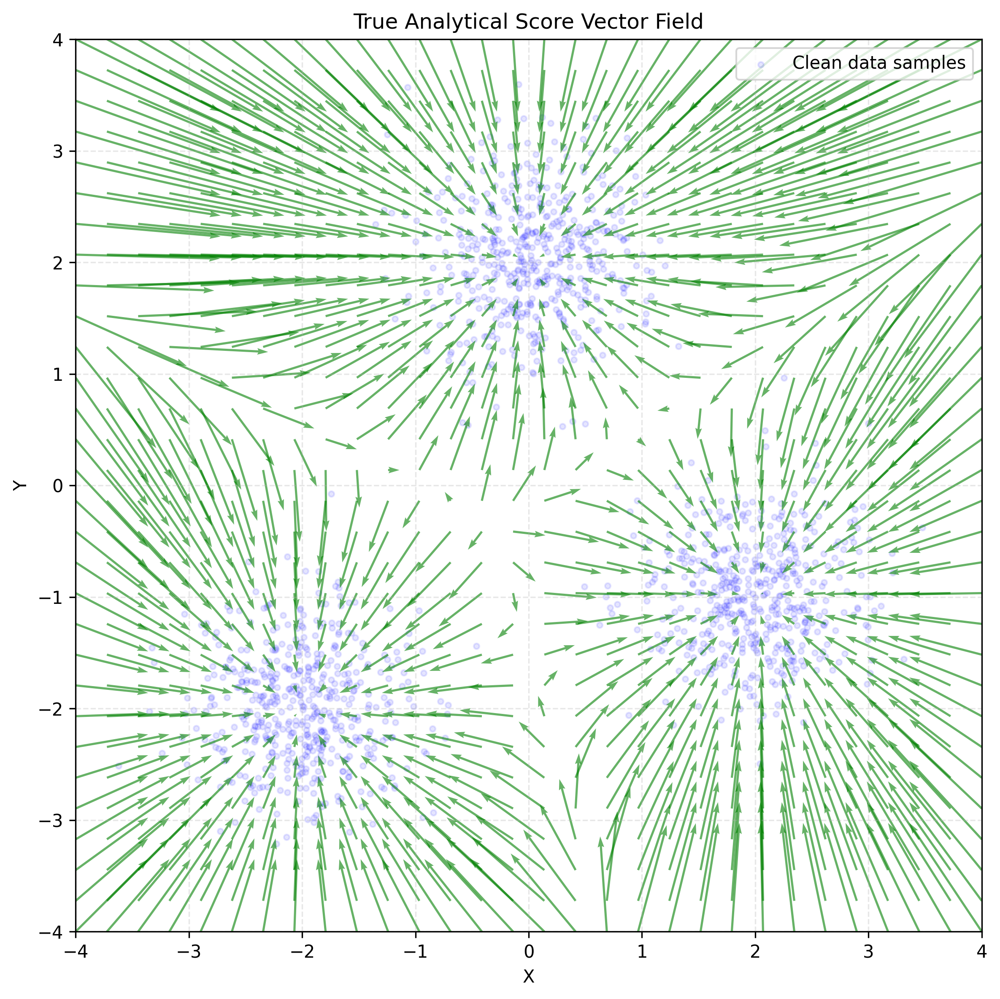
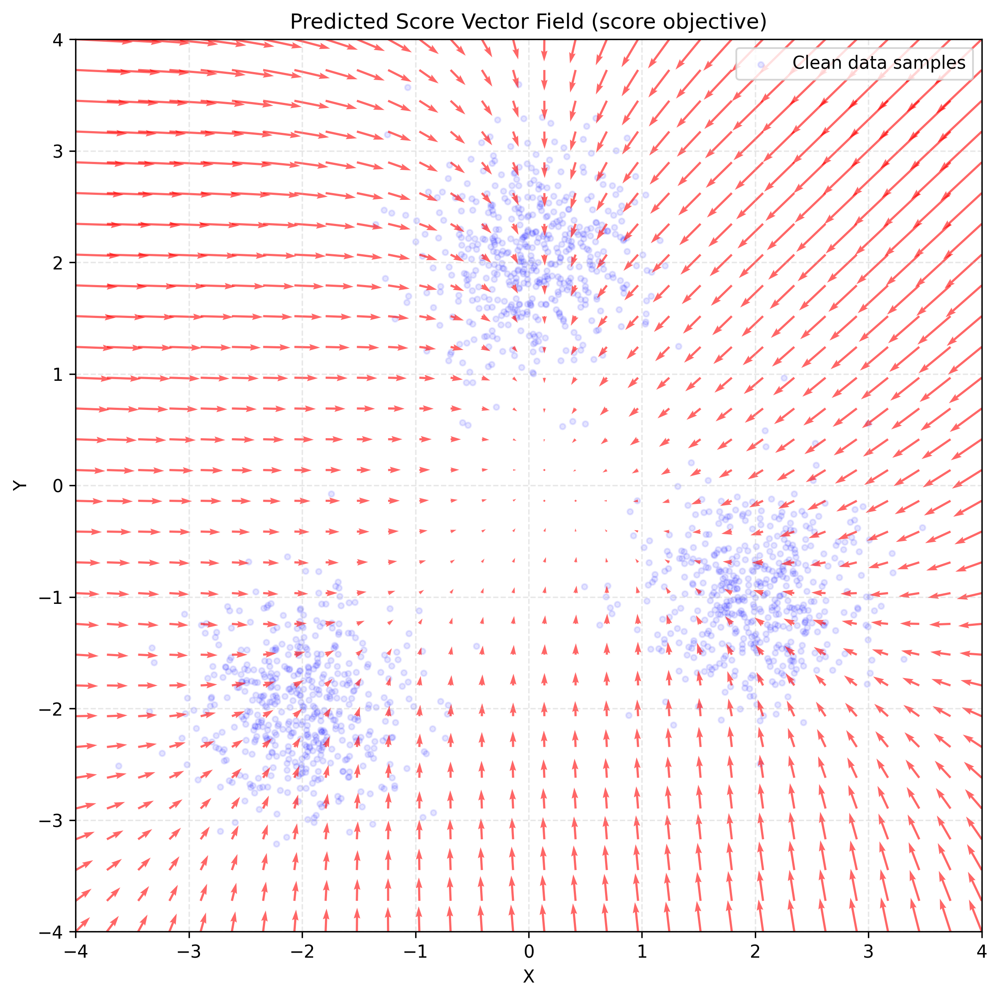

# Blog Post — Working Draft

**Status:** Final manuscript approved on 2026-10-29. The HTML post and its
assets were committed and pushed to the blog repository in
[`449fb84`](https://github.com/juancopi81/juancopi81.github.io/commit/449fb840931c5484be47493871b00a0d828adcd5).
**Study source:** [Completed Week 14 report](report.md).
**Blog title:** VAE, RealNVP, and a Score Toy — approved for now by the author.
**Post:** [VAE, RealNVP, and a Score Toy](https://juancopi81.github.io/posts/2026-10-29-vae-realnvp-and-a-score-toy.html).

Over the past few days, I've been revisiting three different approaches
to generative modeling: VAE, RealNVP, and score models—in this case, a "toy"
version with one fixed noise level. They all use probability theory and
distributions from which we know how to sample, like a standard normal, to
study complex data distributions, such as distributions over images.

These methods have different strategies, with their own advantages and
limitations, and show us how researchers come up with different architectures
using common knowledge. Seeing them in retrospect could make you feel like
"I could have thought of that..." but
["hindsight is 20/20"](https://www.merriam-webster.com/dictionary/twenty-twenty%20hindsight).
All three use clever insights and engineering tricks that are worth studying
carefully.

On a personal note, I believe RealNVP is a very clever idea and a wonderful
implementation. When I first learned about the change-of-variables theorem
in [Stat 110](../../notes/w06_stat110_transformations_convolutions.md),
I immediately thought that these transformations should be useful in a
generative model, and here I am reading about normalizing flows. I wonder
if we can still squeeze any more out of this method.

Today, I want to briefly summarize some notes and experiments about
these models, aiming to better organize what I have learned before
moving forward.

## Models and Experiments

This post does not aim to go into the details of each model or explain the
specifics of the code used as learning material to explore the concepts in
a practical manner. For that, I highly recommend going to the following links:

- VAE: [Notes](../../notes/w11_cs236_vae.md) — [Experiment](../../notebooks/w11_minimal_vae_mnist_solved.ipynb).
- RealNVP: [Notes](../../notes/w12_cs236_normalizing_flows.md) — [Experiment](../../notebooks/w12_realnvp_2d_blobs_solved.ipynb).
- Toy Score Model: [Notes](../../notes/w07_conditional_expectation_in_diffusion.md) — [Experiment](../checkpoint_02_toy_score_matching/report.md).

Instead, what I would like to do here is show a concise comparison of these
methods (see the table below) and share some general observations about the
results from the experiments.

Finally, I want to add a small section about how these models connect with
diffusion models and leave some open questions that I might revisit later
in the blog.

## Model Comparison

The table below compares the three experiments linked in the "Models and
Experiments" section. It focuses on the specific setups we used. So, for
example, "Observed limitation" should be read in the context of these
experiments, rather than as a general claim about how the model families
perform.

| Model                 | What it learns                                                       | Training objective                                                                               | Generation in our experiment                                               | Observed limitation                                                                                                          |
| --------------------- | -------------------------------------------------------------------- | ------------------------------------------------------------------------------------------------ | -------------------------------------------------------------------------- | ---------------------------------------------------------------------------------------------------------------------------- |
| VAE                   | Encoder and decoder conditional distributions                        | Minimize negative ELBO: expected reconstruction loss plus KL from approximate posterior to prior | Sample a latent from the prior and display the decoder's mean image        | Several reconstructed digits remained blurry or ambiguous                                                                    |
| RealNVP               | An invertible mapping between data and latent spaces                 | Maximize exact model log-likelihood with the Jacobian correction                                 | Sample from the base distribution and apply the inverse data-to-latent map | With one layer, the first generated coordinate must remain Gaussian. |
| Fixed-noise score toy | The marginal score of the noisy-data distribution at one noise level | Minimize MSE against conditional Gaussian corruption scores                                      | **Not implemented**; the experiment learns and evaluates a score field     | Held-out marginal-score error remained after 20 updates                                                                      |

Let's now explore some results from each experiment to look more closely
at the concepts presented in the table.

### VAE

This panel demonstrates how our VAE experiment learns to reconstruct selected
images from MNIST. In this experiment, we used a two-dimensional latent space
and trained for five epochs. The first row shows the original images. In the second
row, we see the noisy-looking outputs produced before training. Rows 3 and 4
show how, after training, the reconstructions begin to resemble the input
digits. Row 3 uses the **encoder's mean latent vector**, while row 4 uses a
**latent sampled from the encoder's distribution**.

Reconstructions in rows 3 and 4 still show limitations. The digits 0 and 1
are recognizable, while several other digits remain blurry and ambiguous.
For example, the reconstructions of 4, 5, 8, and 9 look very similar despite
coming from different input digits.

_Source: [Week 11 solved notebook](../../notebooks/w11_minimal_vae_mnist_solved.ipynb). Related post: [When the VAE Meets Monte Carlo](https://juancopi81.github.io/posts/2026-10-01-when-the-vae-meets-monte-carlo.html)._

### RealNVP

This figure shows results from RealNVP models trained on two-dimensional
data. On the left, we have the synthetic data from our experiment compared
against generated samples from a one-layer model. The right panel compares
the first-coordinate marginal of the original data with those of the one-
and six-layer models' generated samples.

The one-layer model **leaves its first coordinate unchanged**, so its generated
first-coordinate marginal has the same Gaussian distribution as the first
coordinate of our base distribution. The six-layer model alternates which
coordinate is transformed, allowing both coordinates to change across
layers. In the right panel, it captures the bimodal shape of the data's
first coordinate.

The six-layer model captures the two main peaks. The histograms still differ,
but finite samples also produce differences, so this plot alone does not tell
us how much error remains in the learned distribution.

_Source: [Week 12 solved notebook](../../notebooks/w12_realnvp_2d_blobs_solved.ipynb). Related post: [Changing Variables Without Changing Probability](https://juancopi81.github.io/posts/2026-07-16-transforming-random-variables.html)._

### Fixed-noise Score Toy

| Analytical score field                                                                                                       | Learned score field after 20 updates                                                                                               |
| ---------------------------------------------------------------------------------------------------------------------------- | ---------------------------------------------------------------------------------------------------------------------------------- |
|  |  |

The plots show the vector fields of the analytical score and the learned
score. We can see the magnitude and direction of the scores at different
points on the grid. The analytical field shows the true score of the
noisy-data distribution, with vectors pointing in the direction of increasing
log density. In the learned field, after 20 updates, the vectors seem to
point more broadly toward the central region of the grid, consistent with
a model that is **still underfitted**.

_Source: [Week 8 toy score-matching report](../checkpoint_02_toy_score_matching/report.md), direct-score run. The blue dots are clean data shown for context. Related post: [Two Ways to Learn the Same Score Field](https://juancopi81.github.io/posts/2026-07-30-two-ways-to-learn-the-same-score-field.html)._

## Connection to Diffusion

I started this post by mentioning how these three approaches use probability
theory and simple distributions to study more complex data distributions.
But the connections don't stop there:

- VAEs and related autoencoders are used in latent diffusion models, where
  we compress the data before applying diffusion. The goal here is to reduce
  computational costs by running diffusion in a smaller latent representation
  of complex data, like images or sound (see
  [Latent Diffusion Models](https://arxiv.org/abs/2112.10752) and
  [AudioLDM](https://arxiv.org/abs/2301.12503)).
- The score toy is a step toward a score-based diffusion model: it already
  includes Gaussian forward corruption and a training objective that teaches
  the network to approximate the marginal score of the noisy-data distribution.
  To develop this toy into a full diffusion model, we still need to train
  across multiple noise levels, give the model the corresponding noise level,
  and add a proper sampling procedure that moves from a suitable high-noise
  distribution toward the data distribution.
- Score-based diffusion also has a deterministic formulation through the
  [probability-flow ODE](https://arxiv.org/html/2011.13456v2#S4.SS3), which
  connects it to continuous normalizing flows. The details of this connection
  are outside the scope of this post.

## What I Think I Learned

Probability is such a powerful tool! We just saw three different approaches
to generative modeling, using ideas about conditional and marginal
distributions—from the very clever engineering of RealNVP to learning a vector
field in the score toy. It kind of makes you feel bad because, having the
pieces, you didn’t think of that solution yourself—or maybe **you** did? But
it also makes me hopeful and makes me wonder whether there are still many
open ideas to explore. I think there are.

Personally, this review helped me clarify theoretical concepts, such as
conditional expectations and marginal distributions, in a practical way and
see how those concepts become images you can inspect, vector fields you can
compare, and loss curves going down. One thing I’d like to highlight from
this exploration is RealNVP. I wasn’t very familiar with this architecture,
and I was amazed by how they made an invertible mapping work inside a complex
neural network! _Chapeau!_

## Open Questions

- Stat 110 also presents the
  [universality of the uniform](../../notes/w03_stat110_normal_dist.md)
  before the change-of-variables topic. I'd like to explore more deeply how
  inverse-CDF sampling relates to the change-of-variables formula for densities.
- I haven't explored the connection between RealNVP and diffusion models in
  much detail in this post. How does the probability-flow ODE connect diffusion
  models to continuous normalizing flows?
- I mentioned that VAEs can help reduce the computational cost of diffusion
  models. What are the trade-offs of working in latent space versus pixel space?

## References

- [Diederik P. Kingma and Max Welling: Auto-Encoding Variational Bayes](https://arxiv.org/abs/1312.6114).
- [Laurent Dinh, Jascha Sohl-Dickstein, and Samy Bengio: Density estimation using Real NVP](https://arxiv.org/abs/1605.08803).
- [Yang Song et al.: Score-Based Generative Modeling through Stochastic Differential Equations](https://arxiv.org/abs/2011.13456).
- [Robin Rombach et al.: High-Resolution Image Synthesis with Latent Diffusion Models](https://arxiv.org/abs/2112.10752).
- [Haohe Liu et al.: AudioLDM: Text-to-Audio Generation with Latent Diffusion Models](https://arxiv.org/abs/2301.12503).
