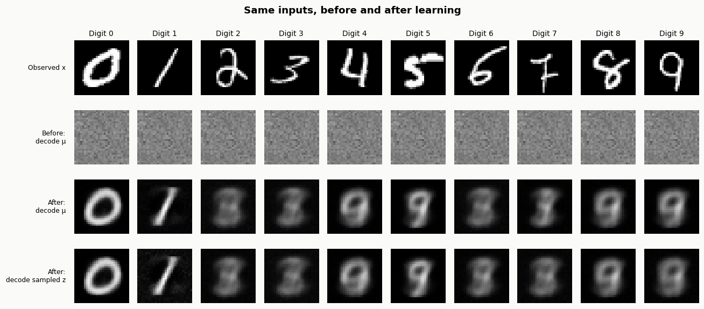
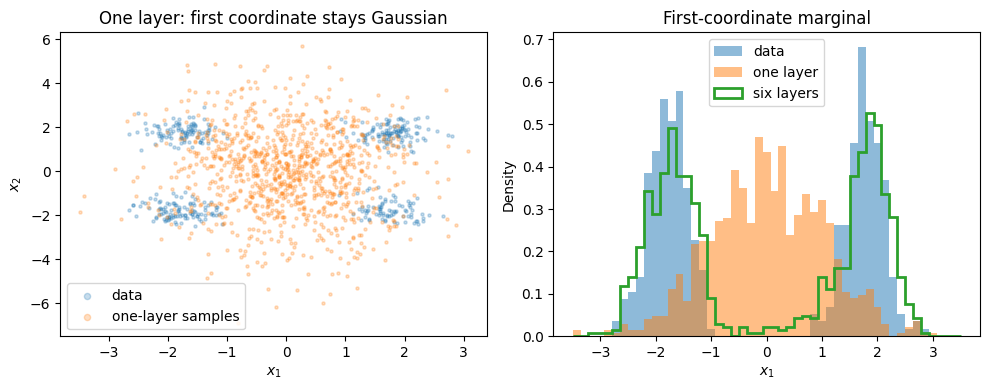

# Week 14 — Manuscript Draft

**Status:** Study draft reviewed by the author on 2026-10-26; connections
between sections remain for final blog editing.
**Study checkpoint:** Completed on 2026-10-27; [review record](../../notes/w14_study_plan.md#day-7-completion-decision).
**Final blog title:** Awaiting the author.

Over the past few days, I have been working with three different approaches
to generative modeling: VAE, RealNVP, and score models—in this case, a "toy"
version with one fixed noise level. They all use probability theory and
distributions from which we know how to sample, like a standard normal, to
study complex data distributions, such as distributions over images.

These methods have different strategies, with their own advantages and
limitations, and show us how researchers come up with different architectures
using common knowledge. Seeing them in retrospect could make you feel like
"I could have thought of that..." but
["hindsight is 20/20"](https://www.merriam-webster.com/dictionary/twenty-twenty%20hindsight).
All three use clever insights and engineering tricks that are worth studying
carefully.

On a personal note, I believe RealNVP is a very clever idea and a wonderful
implementation. When I first learned about the change-of-variables theorem
in [Stats 110](../../notes/w06_stat110_transformations_convolutions.md),
I immediately thought that these transformations should be useful in a
generative model, and here I am reading about normalizing flows. I wonder
if we can still squeeze any more out of this method.

Today, I want to briefly summarize some notes and experiments about the
aforementioned models, aiming to better organize what I have learned before
moving forward.

## Models and Experiments

This post does not aim to go into the details of each model or explain the
specifics of the code used as learning material to explore the concepts in
a practical manner. For that, I highly recommend going to the following links:

- VAE: [Notes](../../notes/w11_cs236_vae.md) — [Experiment](../../notebooks/w11_minimal_vae_mnist_solved.ipynb).
- RealNVP: [Notes](../../notes/w12_cs236_normalizing_flows.md) — [Experiment](../../notebooks/w12_realnvp_2d_blobs_solved.ipynb).
- Toy Score Model: [Notes](../../notes/w07_conditional_expectation_in_diffusion.md) — [Experiment](../checkpoint_02_toy_score_matching/report.md).

Instead, what I would like to do here is show a concise comparison of these
methods (see the table below) and share some general observations about the
artifacts generated during the experiments.

Finally, I want to add a small section about how these models connect with
diffusion models and leave some open questions that I might revisit later
in the blog.

## Model Comparison

| Model | What it learns | Training objective | Generation in our experiment | Observed limitation |
| --- | --- | --- | --- | --- |
| VAE | Encoder and decoder conditional distributions | Minimize negative ELBO: expected reconstruction loss plus KL from approximate posterior to prior | Sample a latent from the prior and display the decoder's mean image | Several reconstructed digits remained blurry or ambiguous |
| RealNVP | An invertible mapping between data and latent spaces | Maximize exact model log-likelihood with the Jacobian correction | Sample from the base distribution and apply the inverse data-to-latent map | One layer leaves the first generated marginal Gaussian; the six-layer sample histogram still differs from the data histogram |
| Fixed-noise score toy | The marginal score of the noisy-data distribution at one noise level | Minimize MSE against conditional Gaussian corruption scores | Not implemented; the experiment learns and evaluates a score field | Held-out marginal-score error remained after 20 updates |

## VAE

This panel demonstrates how our VAE experiment learns to reconstruct selected
images from MNIST. The first row shows the original images. In the second
row, we see the noisy-looking outputs produced before training. Rows 3 and 4
show how, after training, the reconstructions begin to resemble the input
digits. Row 3 uses the encoder's mean latent vector, while row 4 uses a latent
sampled from the encoder's distribution.

Reconstructions in rows 3 and 4 still show limitations. The digits 0 and 1
are recognizable, while several other digits remain blurry and ambiguous.
For example, the reconstructions of 4, 5, 8, and 9 look very similar despite
coming from different input digits.

*Source: [Week 11 solved notebook](../../notebooks/w11_minimal_vae_mnist_solved.ipynb).*

## RealNVP

This figure shows results from RealNVP models trained on two-dimensional
data. On the left, we have the synthetic data from our experiment compared
against generated samples from a one-layer model. The right panel compares
the first-coordinate marginal of the original data with those of the one-
and six-layer models' generated samples.

The one-layer model leaves its first coordinate unchanged, so its generated
first-coordinate marginal has the same Gaussian distribution as the first
coordinate of our base distribution. The six-layer model alternates which
coordinate is transformed, allowing both coordinates to change across
layers. In the right panel, it captures the bimodal shape of the data's
first coordinate.

Still, even with six layers, the green histogram does not perfectly align
with the blue data histogram, although it captures the two main peaks.

*Source: [Week 12 solved notebook](../../notebooks/w12_realnvp_2d_blobs_solved.ipynb).*

## Fixed-noise Score Toy

The three-panel figure shows an experiment applying gradient clipping to
our toy score model. When clipping was on, we capped the global gradient
norm used for each parameter update at 0.5. Without clipping, we applied
the gradients without that restriction as the control condition.

In this experiment, clipping bounded the applied gradient norm as intended,
but it did not improve held-out score accuracy over 20 updates. The model
trained without clipping achieved lower held-out marginal-score MSE.

*Source: [Week 13 stability note](../../notes/w13_training_stability_for_diffusion.md).*

## Connection to Diffusion

The score toy is a step toward a score-based diffusion model: it already
includes Gaussian forward corruption and a training objective that teaches
the network to approximate the marginal score of the noisy-data distribution.
The model learned through gradient-based training, with improvement shown
by the decrease in held-out marginal-score MSE. We still need to train across
multiple noise levels, give the model the corresponding noise level, and add
a proper sampling procedure that moves from a suitable high-noise
distribution toward the data distribution.
