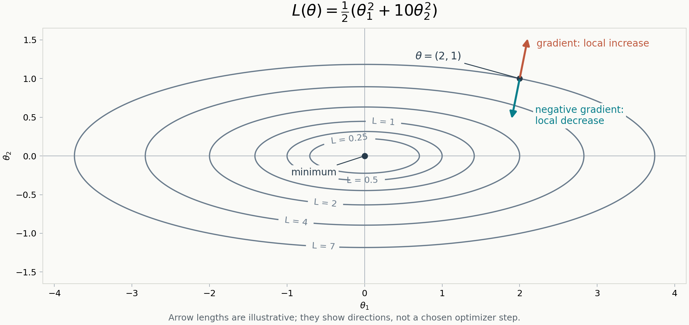
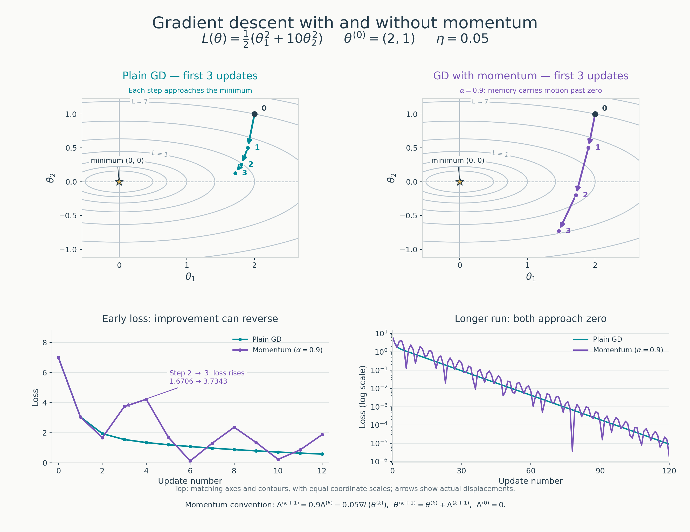

# Week 13 — Optimization Basics

**Status:** Complete — Week 13 consolidated on 2026-10-14.
Session 1 handwritten geometry and
understanding checkpoints reviewed on 2026-10-05.
Session 2 handwritten updates, recurrences, and step-size checkpoint
reviewed on 2026-10-06.
Session 3 momentum calculations and conceptual checkpoints reviewed on
2026-10-07.
Session 4 minibatch gradients, corruption noise, and the stochastic-step
checkpoint reviewed on 2026-10-08.
Session 5 Adam calculations and conceptual checkpoints reviewed on
2026-10-09.
Session 6 optimizer implementations, learning-rate comparisons, and
behavior explanations reviewed on 2026-10-12.
Session 7 controlled score-training clipping experiment and interpretation
reviewed on 2026-10-13.
Session 8 model-objective comparison, instability diagnosis, and the learner's
question round completed on 2026-10-14.

**Source basis:** The opening of MML §7.1, printed pages 227–228, checked
against the local study copy. See the [MML source catalog](../sources/mml/README.md)
and the [official book](https://mml-book.github.io/book/mml-book.pdf).
The momentum convention uses MML §7.1.2, equations 7.11–7.12 on printed
page 231, checked against the local copy during Session 3 setup.
Session 4 uses MML §7.1.3, printed pages 231–233, and the existing
[Week 8 training loop](../mini_projects/checkpoint_02_toy_score_matching/train.py),
checked during our review. The expectation derivations and stochastic-gradient
counterexample below are independent study examples.
Session 5 uses [Adam, Algorithm 1 and §§2–3](https://arxiv.org/pdf/1412.6980),
checked against the paper, together with the supplied handwritten equations,
spreadsheet screenshot, and constant-gradient derivation.
The quadratic below is our practice objective. Its calculations and figure
are an independent consolidation of the handwritten work, not MML's worked
example or an official solution.

## Session 1 — Recover the Geometry of Gradient Descent

The question for today is: once a loss measures how well our model is doing,
what does its gradient tell us about changing the parameters?

### The Objective and Its Matrix Form

Let the parameter vector be a column vector and define

$$
\theta=
\begin{bmatrix}\theta_1\\\theta_2\end{bmatrix},
\qquad
A=
\begin{bmatrix}1&0\\0&10\end{bmatrix}.
$$

Our scalar loss is

$$
\begin{aligned}
L(\theta)
&=\frac12\theta^\top A\theta\\
&=\frac12
\begin{bmatrix}\theta_1&\theta_2\end{bmatrix}
\begin{bmatrix}\theta_1\\10\theta_2\end{bmatrix}\\
&=\frac12(\theta_1^2+10\theta_2^2)\\
&=\frac{\theta_1^2}{2}+5\theta_2^2.
\end{aligned}
$$

Both terms are nonnegative. The unique minimum is at $\theta=(0,0)^\top$,
where $L(\theta)=0$.

### Partial Derivatives, Row Derivative, and Column Gradient

Holding the other coordinate fixed gives

$$
\frac{\partial L}{\partial\theta_1}=\theta_1,
\qquad
\frac{\partial L}{\partial\theta_2}=10\theta_2.
$$

The handwritten row-vector calculation is valid in MML's convention:

$$
\frac{\partial L}{\partial\theta}
=\theta^\top A
=\begin{bmatrix}\theta_1&10\theta_2\end{bmatrix}.
$$

Following the [Week 10 convention](./w10_mml_multivariate_gaussian.md#gradient-convention),
we use $\nabla_\theta L$ for the **column gradient**:

$$
\nabla_\theta L
=\left(\frac{\partial L}{\partial\theta}\right)^\top
=A\theta
=\begin{bmatrix}\theta_1\\10\theta_2\end{bmatrix}.
$$

The equality with $A\theta$ uses the symmetry of $A$. The row and column
expressions contain the same partial derivatives; their shapes determine
how they enter a matrix product or a parameter update.

### The Total Differential

For an infinitesimal parameter displacement $d\theta$,

$$
\begin{aligned}
dL
&=\frac{\partial L}{\partial\theta}\,d\theta\\
&=(\nabla_\theta L)^\top d\theta\\
&=\theta^\top A\,d\theta\\
&=\begin{bmatrix}\theta_1&10\theta_2\end{bmatrix}
\begin{bmatrix}d\theta_1\\d\theta_2\end{bmatrix}\\
&=\theta_1\,d\theta_1+10\theta_2\,d\theta_2.
\end{aligned}
$$

In the handwritten intermediate line, the row multiplying $d\theta$ must
retain the factor $10$ in its second entry. The final expanded line was
already correct.

For a small finite displacement $\Delta\theta$, this differential gives the
first-order approximation

$$
L(\theta+\Delta\theta)-L(\theta)
\approx(\nabla_\theta L)^\top\Delta\theta.
$$

### Contours and Why One Direction Is Steeper

A contour contains parameter values with the same loss $L(\theta)=c$.
For $c>0$,

$$
\frac{\theta_1^2}{2}+5\theta_2^2=c
\quad\Longleftrightarrow\quad
\frac{\theta_1^2}{2c}+\frac{\theta_2^2}{c/5}=1.
$$

These are ellipses centered at the origin, with intercepts

$$
\theta_1=\pm\sqrt{2c}\quad(\theta_2=0),
\qquad
\theta_2=\pm\sqrt{c/5}\quad(\theta_1=0).
$$

The horizontal semi-axis is $\sqrt{10}$ times the vertical semi-axis.
At $c=0$, the contour reduces to the origin.



The ellipses are compressed vertically because the $\theta_2$ direction has
greater curvature:

$$
\frac{\partial^2 L}{\partial\theta_1^2}=1,
\qquad
\frac{\partial^2 L}{\partial\theta_2^2}=10.
$$

From the origin, equal-sized displacements along the two coordinate axes
produce ten times as much loss in the $\theta_2$ direction. More generally,
the local slopes are $\theta_1$ and $10\theta_2$: their relative size depends
on the current point. For example, the vertical slope is zero when
$\theta_2=0$, despite the greater vertical curvature.

At a point away from the origin, the gradient is perpendicular to the
contour and points toward the steepest local increase in loss, using
ordinary Euclidean distance. Its negative points toward the steepest local
decrease. This direction need not point directly at the origin.

### Loss, Gradient, Learning Rate, and Update

These are four different quantities:

| Quantity                                                     | Meaning                                                                                                                                                    |
| ------------------------------------------------------------ | ---------------------------------------------------------------------------------------------------------------------------------------------------------- |
| Loss $L(\theta)$                                             | A scalar measuring the objective at the current parameters.                                                                                                |
| Gradient $\nabla_\theta L(\theta)$                           | A vector of local rates of change; its orientation gives the steepest ascent direction and its norm gives the maximum directional slope per unit distance. |
| Learning rate $\eta$                                         | A positive scalar scaling the gradient in the update.                                                                                                      |
| Parameter update $\Delta\theta=-\eta\nabla_\theta L(\theta)$ | The actual displacement applied to the parameters.                                                                                                         |

Plain gradient descent uses the current gradient to form the next parameters:

$$
\theta_{k+1}=\theta_k-\eta\nabla_\theta L(\theta_k).
$$

The distance moved is $\|\Delta\theta\|_2=\eta\|\nabla_\theta L\|_2$.
The learning rate alone does not specify that distance.

Substituting the update into the first-order approximation gives

$$
L(\theta-\eta\nabla_\theta L)-L(\theta)
\approx-\eta\|\nabla_\theta L\|_2^2.
$$

At a point with a nonzero gradient, this explains why a sufficiently small
positive step decreases the loss. The approximation is local: a large step
can increase the loss. The coordinate recurrences and learning-rate
comparisons belong to Session 2.

### Parameter Gradient Versus Data-Space Score

In training, $\nabla_\theta L$ differentiates the training objective with
respect to **model parameters**. The optimizer changes those parameters to
reduce the objective.

The score from Week 10 is

$$
s(x)=\nabla_x\log p(x).
$$

It differentiates a log-density with respect to the **data coordinates**,
holding the distribution fixed. It points toward the steepest local
increase in log-density in data space.

For noisy data, the relevant density is $p_\sigma(x)$, the distribution at
noise level $\sigma$. Its score is $\nabla_x\log p_\sigma(x)$, with the noise
level held fixed while differentiating with respect to $x$.

For a score network $s_\theta(x)$, the network output is a vector in data
space. Training still uses $\nabla_\theta L$ to adjust its parameters so
that those outputs approximate the target score. The output score and the
gradient used by the optimizer play different roles and generally have
different dimensions.

### Reviewed Example

At $\theta=(2,1)^\top$, the loss and gradient are

$$
L(2,1)=\frac12(2^2+10\cdot1^2)=7,
\qquad
\nabla_\theta L(2,1)=\begin{bmatrix}2\\10\end{bmatrix}.
$$

The scalar loss identifies the contour; the gradient gives the local rates
of change. A learning rate is also needed to compute the parameter
displacement. MML calls it $\gamma$; these notes use $\eta$.

The direction straight toward the minimum is $(-2,-1)^\top$, while the
negative gradient is $(-2,-10)^\top$. The greater curvature along
$\theta_2$ makes reducing that coordinate more effective locally. Steepest
descent describes the greatest local loss decrease among infinitesimal
moves of equal Euclidean length.

### Understanding Checkpoints

Reviewed together on 2026-10-05:

- [x] Recover the matrix form, partial derivatives, and differential from the
      scalar objective.
- [x] Explain the ellipse intercepts and the greater curvature along $\theta_2$.
- [x] Distinguish the loss value, gradient direction, learning rate, and actual
      parameter displacement.
- [x] Distinguish a parameter gradient $\nabla_\theta L$ from a data-space score
      $\nabla_x\log p(x)$.

## Session 2 — Learning Rate and Curvature

The first two gradient-descent updates, coordinate recurrences, and
predictions for $\eta=0.05$, $0.15$, and $0.25$ are consolidated in the
[optimizer-update proof write-up](../proofs/w13_optimizer_updates.md#1-gradient-descent-on-the-practice-quadratic).

For this quadratic, the update multiplies the coordinates by $1-\eta$ and
$1-10\eta$. The learning rate therefore interacts differently with the
curvature of each direction. Sign changes describe oscillation; the absolute
values of the multipliers determine whether its amplitude shrinks or grows.

The negative gradient describes a local downhill direction. With
$\eta=0.25$, the first update moves $\theta_2$ from $1$ to $-1.5$: it crosses
zero and lands farther away, increasing that coordinate's loss contribution.
The total loss rises from $7$ to $12.375$.

Crossing zero can still improve the loss. With $\eta=0.15$, $\theta_2$ moves
from $1$ to $-0.5$, closer to zero. The distinction is how far the step lands
beyond the minimum. The recurrences give the convergence range
$0<\eta<0.2$ for this quadratic from our starting point.

**Checkpoint reviewed on 2026-10-06:** Explain why moving in the negative-gradient
direction can still increase the loss when the step is too large.

## Session 3 — Give the Optimizer Memory: Momentum

The handwritten momentum rule, initialization, first two updates,
additional third update, and comparison with plain gradient descent are
consolidated in the
[momentum proof section](../proofs/w13_optimizer_updates.md#2-gradient-descent-with-momentum).

The chosen convention stores the previous parameter displacement:

$$
\begin{aligned}
\Delta^{(k+1)}&=\alpha\Delta^{(k)}-\eta\nabla_\theta L\bigl(\theta^{(k)}\bigr),\\
\theta^{(k+1)}&=\theta^{(k)}+\Delta^{(k+1)}.
\end{aligned}
$$

For the hand calculations, $\theta^{(0)}=(2,1)^\top$,
$\Delta^{(0)}=(0,0)^\top$, $\eta=0.05$, and $\alpha=0.9$.

### Comparing MML with Andrew Ng's Momentum Convention

The screenshot supplied during our 2026-10-07 review shows Andrew Ng's
[momentum lecture](https://www.youtube.com/watch?v=k8fTYJPd3_I) using an
exponential moving average of gradients. The equations below transcribe
that visible convention into our vector notation; the equivalence
derivation is our independent check, rather than a transcript of the full
video.

Andrew's $\alpha$ denotes the **learning rate**, while MML's $\alpha$
denotes the **momentum coefficient**. To avoid this collision, write
Andrew's learning rate as $\eta_{\mathrm{Ng}}$:

$$
\begin{aligned}
v^{(k+1)}&=\beta v^{(k)}+(1-\beta)g^{(k)},\\
\theta^{(k+1)}&=\theta^{(k)}-\eta_{\mathrm{Ng}}v^{(k+1)},
\qquad g^{(k)}=\nabla_\theta L\bigl(\theta^{(k)}\bigr).
\end{aligned}
$$

Here $v$ stores a smoothed gradient, whereas our $\Delta$ stores the signed
parameter displacement. With a constant learning rate, define

$$
\Delta^{(k)}=-\eta_{\mathrm{Ng}}v^{(k)}.
$$

Multiplying the moving-average rule by $-\eta_{\mathrm{Ng}}$ gives

$$
\begin{aligned}
\Delta^{(k+1)}
&=\beta\Delta^{(k)}-\eta_{\mathrm{Ng}}(1-\beta)g^{(k)}\\
&=\alpha_{\mathrm{MML}}\Delta^{(k)}-\eta_{\mathrm{MML}}g^{(k)}.
\end{aligned}
$$

Thus the conventions produce identical parameter updates when

$$
\boxed{\alpha_{\mathrm{MML}}=\beta,
\qquad \eta_{\mathrm{MML}}=(1-\beta)\eta_{\mathrm{Ng}}.}
$$

| Role                 | Andrew Ng's slide                           | MML / our hand calculations     |
| -------------------- | ------------------------------------------- | ------------------------------- |
| Momentum coefficient | $\beta$                                     | $\alpha$                        |
| Learning rate        | $\alpha$, renamed $\eta_{\mathrm{Ng}}$ here | $\gamma$ in MML, $\eta$ here    |
| Stored state         | Smoothed gradient $v$                       | Parameter displacement $\Delta$ |

The factor $1-\beta$ is absorbed into the **learning rate**, not MML's
momentum coefficient $\alpha$. It normalizes the gradient weights: for a
constant gradient and zero initial state, $v$ approaches that gradient
when $0\leq\beta<1$.

For our $\alpha_{\mathrm{MML}}=0.9$ and $\eta_{\mathrm{MML}}=0.05$,
the equivalent settings are $\beta=0.9$ and
$\eta_{\mathrm{Ng}}=0.05/(1-0.9)=0.5$. With $v^{(0)}=0$, the first
smoothed gradient is $(0.2,1)^\top$, giving the same displacement
$(-0.1,-0.5)^\top$ and the same next point $(1.9,0.5)^\top$.

Using $0.05$ as Andrew's learning rate instead would give the first point
$(1.99,0.95)^\top$. Equal numerical learning rates across these conventions
therefore do not produce equal trajectories.

This comparison assumes fixed coefficients, constant learning rates,
the same starting parameters, matched zero initial states, and the
displayed moving average without bias correction. It explains why we
write down a convention and its initialization before calculating updates.

### Memory and Motion in a Narrow Valley

The stored displacement already contains earlier contributions. Carrying
it forward therefore retains a decaying history of negative-gradient
contributions, rather than only the latest gradient.

- Consistently directed contributions can reinforce each other and build
  sustained motion along a valley.
- Alternating contributions across a valley can partially cancel and damp
  zigzagging. The gradient's sign still depends on the current location on
  the loss surface; momentum can delay the update's reversal.
- Retained motion can dominate the fresh contribution, so momentum still
  needs a suitable learning rate and momentum coefficient.

The extra third handwritten update illustrates the last point. In the
second coordinate, retained motion contributes $-0.63$ while current
descent contributes $+0.1$. Their sum is $-0.53$, moving $\theta_2$ from
$-0.2$ to $-0.73$, farther from zero. Total loss increases from about
$1.6706$ to $3.7343$.

The learning rate $\eta$ and memory coefficient $\alpha$ must be considered
together. An individual loss increase does not establish divergence: an
independent recurrence check in the proof confirms that our chosen pair
still converges eventually on this quadratic.

### Visual Comparison with Plain Gradient Descent



Both methods start at $(2,1)^\top$ and use $\eta=0.05$. Momentum uses our
displacement convention with $\alpha=0.9$ and $\Delta^{(0)}=0$. The top
panels show exactly the first three updates, using identical axes,
contours, and equal coordinate scales. The arrows are actual updates.

The bottom panels extend the calculation independently to 12 and 120
updates. Plain GD decreases the loss at every step here. Momentum initially
improves it, then raises it from $1.6706$ to $3.7343$ at update 3; later
oscillations decay. Both losses approach zero with these settings.

This example shows how memory changes the trajectory. It does not establish
that momentum always smooths motion or always reaches a lower loss than GD
at a given iteration. The settings are our hand-calculation choices, rather
than separately tuned choices for each optimizer.

**Checkpoints reviewed on 2026-10-07:** What momentum remembers, the effect
of agreeing or alternating gradients, why it can help in a narrow valley,
and why a suitable learning rate is still necessary.

## Session 4 — Where Stochastic Gradients Come From

### Fix the Dataset and Parameters Before Taking an Expectation

Suppose the training dataset contains $N$ examples, and $\ell_i(\theta)$
is the loss for example $i$. Write the full training loss as an average:

$$
L(\theta)=\frac1N\sum_{i=1}^{N}\ell_i(\theta),
\qquad
\nabla_\theta L(\theta)=\frac1N\sum_{i=1}^{N}\nabla_\theta\ell_i(\theta).
$$

MML equation 7.13 writes the objective as a sum. We use an average to make
the Monte Carlo connection explicit. The two objectives have the same
minimizers, but their gradients differ by a factor of $N$, which matters
when choosing a numerical learning rate.

Hold the dataset and current parameters $\theta$ fixed. Choose an index
$I$ uniformly from $\{1,\ldots,N\}$ and compute the random gradient
estimator $g_I=\nabla_\theta\ell_I(\theta)$. Its expectation is

$$
\begin{aligned}
\mathbb E_I[g_I]
&=\sum_{i=1}^{N}\frac1N\nabla_\theta\ell_i(\theta)\\
&=\nabla_\theta\left(\frac1N\sum_{i=1}^{N}\ell_i(\theta)\right)\\
&=\nabla_\theta L(\theta).
\end{aligned}
$$

The random quantity $g_I$ is an **unbiased estimator** of the full gradient.
Its expectation equals the full gradient; an individual draw can differ
in both magnitude and direction. The expectation itself is the target
average, rather than another random gradient estimate.

### Minibatches Connect SGD to Monte Carlo

For $m$ independently and uniformly sampled indices, average their gradients:

$$
\widehat g_B(\theta)=\frac1m\sum_{j=1}^{m}g_{I_j},
\qquad
\mathbb E[\widehat g_B(\theta)]=\nabla_\theta L(\theta).
$$

The stochastic update uses this estimate at the current parameter vector:

$$
\theta^{(k+1)}
=\theta^{(k)}-\eta\widehat g_B\bigl(\theta^{(k)}\bigr).
$$

This follows the same pattern as our earlier Monte Carlo area example:
sample random inputs, evaluate a quantity for each input, and average.
There, the indicator average estimates a hit probability; multiplying by
the rectangle's area estimates the region's area. Here, we average gradient
vectors to estimate the full gradient.

With independent draws and fixed $\theta$, the variance of any gradient
coordinate $r$ satisfies

$$
\operatorname{Var}(\widehat g_{B,r})
=\frac1{m^2}\sum_{j=1}^{m}\operatorname{Var}(g_{I_j,r})
=\frac{\operatorname{Var}(g_{I,r})}{m}.
$$

Larger batches give estimates more concentrated around the full gradient,
at greater computational cost. They do not guarantee that each particular
estimate is closer. This variance formula assumes sampling with replacement;
sampling a subset without replacement remains unbiased, but changes the
variance formula. Using every example once removes randomness from example
selection when no other randomness is present.

### Two Sources of Gradient Randomness

| Source           | What changes with parameters held fixed? | Effect on the estimated gradient                          |
| ---------------- | ---------------------------------------- | --------------------------------------------------------- |
| Data sampling    | Which clean examples enter the batch     | Different examples contribute different loss gradients    |
| Corruption noise | The noise added to each clean example    | Noisy inputs and, for the score objective, targets change |

The Week 8 score model uses the entire clean training set each iteration,
but draws fresh noise inside the loop:

```python
train_noise = torch.randn_like(train_x0)
train_xt = train_x0 + FORWARD_SIGMA * train_noise
target = -(train_xt - train_x0) / FORWARD_SIGMA**2
```

These are the score-branch expressions at lines 126–135 of the
[training loop](../mini_projects/checkpoint_02_toy_score_matching/train.py#L126).
For $x_t=x_0+\sigma\epsilon$, the conditional Gaussian score target is

$$
-\frac{x_t-x_0}{\sigma^2}=-\frac{\epsilon}{\sigma}.
$$

Different noise draws change the forward corruption, the loss, and its
parameter gradient. The gradients can therefore differ even if we hold
the clean dataset and model parameters fixed. Parameter changes during
training also change gradients, but are distinct from the randomness we
are isolating here.

To describe the full objective for this model, include the expectation
over corruption noise. Let $s_\theta$ be the score network and $d=2$ the
number of data coordinates. Its per-example loss is

$$
\ell_i(\theta,\epsilon)
=\frac1d\left\|s_\theta(x_i+\sigma\epsilon)
+\frac{\epsilon}{\sigma}\right\|_2^2,
\qquad \epsilon\sim\mathcal N(0,I_d).
$$

The factor $1/d$ matches the code's mean reduction over coordinate errors.
The objective and its sampled training estimate are

$$
\mathcal L(\theta)
=\frac1N\sum_{i=1}^{N}\mathbb E_\epsilon[\ell_i(\theta,\epsilon)],
\qquad
\widehat{\mathcal L}(\theta)
=\frac1N\sum_{i=1}^{N}\ell_i(\theta,\epsilon_i).
$$

Using every clean example does not evaluate the noise expectation exactly.
Fresh draws $\epsilon_i$ still make the gradient of the sampled loss random.
Under the usual conditions allowing differentiation through the expectation,
that gradient is unbiased for $\nabla_\theta\mathcal L(\theta)$.

### An Unbiased Gradient Can Produce an Uphill Step

Return to our practice quadratic at $\theta=(2,1)^\top$:

$$
L(\theta)=7,
\qquad
\nabla_\theta L(\theta)=\begin{bmatrix}2\\10\end{bmatrix}.
$$

For an independent thought experiment, let a random estimator return
$(2,-10)^\top$ or $(2,30)^\top$, each with probability $1/2$. It is unbiased:

$$
\mathbb E[\widehat g]
=\frac12\begin{bmatrix}2\\-10\end{bmatrix}
+\frac12\begin{bmatrix}2\\30\end{bmatrix}
=\begin{bmatrix}2\\10\end{bmatrix}.
$$

If the draw is $\widehat g=(2,-10)^\top$ and $\eta=0.05$, the update is

$$
\theta_{\mathrm{new}}
=\begin{bmatrix}2\\1\end{bmatrix}
-0.05\begin{bmatrix}2\\-10\end{bmatrix}
=\begin{bmatrix}1.9\\1.5\end{bmatrix},
\qquad
L(\theta_{\mathrm{new}})
=\frac12(1.9^2+10\cdot1.5^2)=13.055.
$$

The sampled gradient reverses the second component's sign, so the update
moves $\theta_2$ farther from zero. The full loss increases even though
$\eta=0.05$ was suitable for gradient descent using the full gradient.
This constructed estimator illustrates the issue; it is not a measured
gradient from the Week 8 model.

Our reviewed explanation is: **the estimator equals the full gradient on
average; individual draws can differ, including in direction, and can
produce an uphill step.** Unbiasedness guarantees neither a decrease at
every iteration nor convergence by itself. Learning rate, gradient
variability, and properties of the objective also matter.

### Session 4 Review Checkpoints

Reviewed together on 2026-10-08:

- [x] Explain why uniform sampling gives an unbiased estimate of the gradient of an average loss.
- [x] Connect minibatch averaging to Monte Carlo and explain the batch-size effect on variance.
- [x] Identify data sampling and corruption noise as two sources of gradient randomness.
- [x] Explain why the Week 8 full-batch training loop still has stochastic gradients.
- [x] Calculate and explain an individual stochastic step that increases the full objective.

## Session 5 — Understand Adam, Then Calculate It

### Unify the Indexing and Keep the States Separate

The paper labels the upcoming update $t$ and evaluates its gradient at
$\theta_{t-1}$. Our convention labels the current state $k$ and computes
the next state $k+1$. Thus $t=k+1$: the paper's $g_t$ becomes our $g^{(k)}$,
while $m_t$, $v_t$, and $\theta_t$ become our states at $k+1$.

Using the same column gradient as GD and momentum, Adam is

$$
\begin{aligned}
g^{(k)}&=\nabla_\theta L\bigl(\theta^{(k)}\bigr),\\
m^{(k+1)}&=\beta_1m^{(k)}+(1-\beta_1)g^{(k)},\\
v^{(k+1)}&=\beta_2v^{(k)}+(1-\beta_2)
\bigl(g^{(k)}\odot g^{(k)}\bigr),\\
\widehat m^{(k+1)}&=\frac{m^{(k+1)}}{1-\beta_1^{k+1}},\\
\widehat v^{(k+1)}&=\frac{v^{(k+1)}}{1-\beta_2^{k+1}},\\
\theta^{(k+1)}&=\theta^{(k)}
-\eta\frac{\widehat m^{(k+1)}}{\sqrt{\widehat v^{(k+1)}}+\epsilon}.
\end{aligned}
$$

All products, squares, square roots, and divisions involving gradient or
moment coordinates act elementwise. The parameter vector $\theta$, current
gradient $g$, and moment states $m$ and $v$ are separate quantities. Carry
the uncorrected states $m$ and $v$ into the next iteration; their corrected
versions are used in the parameter update.

The hand calculation uses $\theta^{(0)}=(2,1)^\top$,
$m^{(0)}=v^{(0)}=(0,0)^\top$, $\eta=0.05$, $\beta_1=0.9$,
$\beta_2=0.999$, and $\epsilon=10^{-8}$. The paper calls the learning rate
$\alpha$; we retain $\eta$. The chosen rate is our practice setting.

### What Each Term Does

| Term | Role |
| --- | --- |
| $g^{(k)}$ | Parameter gradient evaluated at the current parameter vector |
| $m$ | Moving average of signed gradients, like Andrew Ng's momentum convention |
| $\beta_1$ | Retention of the previous gradient average; older contributions decay with age |
| $v$ | Moving average of coordinate-wise squared gradients |
| $\beta_2$ | Retention of the squared-gradient average; our $0.999$ retains history longer than $0.9$ |
| $1-\beta_1^{k+1}$ and $1-\beta_2^{k+1}$ | Remove the initial-zero weighting after $k+1$ observations |
| $\widehat m$ and $\widehat v$ | Moment estimates corrected for zero initialization |
| $\sqrt{\widehat v}$ | Coordinate-wise root-mean-square gradient scale used to normalize the update |
| $\eta$ | Shared base learning rate multiplying the normalized update |
| $\epsilon$ | Positive numerical stabilizer added outside the square root |

### A Second Raw Moment Is Different from a Variance

For a scalar gradient coordinate $G$, the second raw moment and variance are

$$
\mathbb E[G^2],
\qquad
\operatorname{Var}(G)=\mathbb E[G^2]-(\mathbb E[G])^2.
$$

Adam averages the squares without first subtracting the mean. If a gradient
coordinate is always $2$, its second raw moment is $4$, while its variance
is zero. Our handwritten fixed-point check gives

$$
v_*=\beta_2v_*+(1-\beta_2)4
\quad\Longrightarrow\quad
(1-\beta_2)v_*=(1-\beta_2)4
\quad\Longrightarrow\quad v_*=4,
$$

where cancellation is valid because $\beta_2<1$. In particular, the first
term multiplies the previous squared-gradient average $v$, not the previous
gradient value $2$.

### Correct the Initial-Zero Weighting

In that constant-gradient example, the first value from $v^{(0)}=0$ is
$v^{(1)}=0.999(0)+0.001(4)=0.004$. Bias correction gives

$$
\widehat v^{(1)}=\frac{0.004}{1-0.999}=4.
$$

More generally, $v^{(t)}=4(1-\beta_2^t)$ in this example. The denominator
therefore counts the observations incorporated, giving exponent $k+1$
when our current iteration is $k$. The first-moment correction follows
the same logic. These corrections remove the initialization effect; they
do not remove gradient randomness or changes in the gradient distribution
during training. The [proof write-up](../proofs/w13_optimizer_updates.md#3-adam-on-the-practice-quadratic)
derives the moving-average weights explicitly.

### Normalize the Step and Preserve a Positive Denominator

For our first update, $\widehat m^{(1)}=(2,10)^\top$ and
$\widehat v^{(1)}=(4,100)^\top$. Ignoring the tiny $\epsilon$ temporarily,
their coordinate-wise ratio is $(1,1)^\top$. Both coordinates therefore
move by approximately $\eta=0.05$, despite their different gradient
magnitudes. The base rate is shared throughout; subsequent normalized
ratios can differ because they retain gradient history.

The denominator is $\sqrt{\widehat v}+\epsilon$, with $\epsilon$ **outside**
the square root. If a gradient coordinate has always been zero, both
corrected moments are zero. Omitting $\epsilon$ produces the undefined
ratio $0/0$; including it produces $0/\epsilon=0$, leaving that coordinate
unchanged. For a nonzero denominator, $\epsilon$ is added to the estimated
gradient scale rather than replacing it.

### Verified First Two Updates

The independently recomputed values agree with the supplied spreadsheet
screenshot at its displayed precision:

| Update | Parameter vector after the update |
| --- | --- |
| $1$ | $\theta^{(1)}\approx(1.95,0.95)^\top$ |
| $2$ | $\theta^{(2)}\approx(1.900036998,0.900083243)^\top$ |

The [Adam proof section](../proofs/w13_optimizer_updates.md#3-adam-on-the-practice-quadratic)
records all gradients, moment states, corrections, and parameter updates.

### Session 5 Review Checkpoints

Reviewed together on 2026-10-09:

- [x] Unify the paper's update indexing with our current-state convention.
- [x] Record initialization and hyperparameters, keeping moments separate from parameters.
- [x] Verify the first two Adam updates against the displayed spreadsheet values.
- [x] Connect the first-moment moving average to momentum.
- [x] Distinguish the second raw moment from variance using a constant gradient.
- [x] Explain the zero-initialization correction, coordinate-wise normalization, and role of $\epsilon$.

## Session 6 — Implement and Compare the Three Optimizers

The [working notebook](../notebooks/w13_optimizers_sanity_solved.ipynb)
implements GD, displacement-based momentum, and Adam from scratch on our
shared quadratic. All Session 6 assertions passed in a fresh Python process,
including the first two hand-calculated updates, momentum states, Adam's
uncorrected moment states, and the placement of $\epsilon$ outside the square
root. The comparison starts every run at $(2,1)^\top$ and uses a fixed
120-update budget. These are independent experiments on our practice objective.

### Explain GD Through Its Coordinate Multipliers

The recurrences are $\theta_1^{(k+1)}=(1-\eta)\theta_1^{(k)}$ and
$\theta_2^{(k+1)}=(1-10\eta)\theta_2^{(k)}$.

| Learning rate | Multipliers for $\theta_1$, $\theta_2$ | Behavior |
| --- | --- | --- |
| $0.05$ | $0.95$, $0.5$ | Both coordinates shrink without changing sign. |
| $0.15$ | $0.85$, $-0.5$ | Both coordinates shrink; $\theta_2$ alternates sign. |
| $0.25$ | $0.75$, $-1.5$ | $\theta_1$ shrinks, but $\theta_2$ alternates sign and grows in magnitude. |

For the divergent run, the relevant fact is $|-1.5|>1$: the multiplier itself
is negative. Starting from $\theta_2^{(0)}=1$, we have
$\theta_2^{(k)}=(-1.5)^k$. The corresponding gradient component is
$g_2^{(k)}=10\theta_2^{(k)}$, so its magnitude grows too. Consequently,

$$
\|\nabla_\theta L(\theta^{(k)})\|_2
=\sqrt{\bigl(\theta_1^{(k)}\bigr)^2+100\bigl(\theta_2^{(k)}\bigr)^2}
$$

grows without bound. A run can still have numerically finite values during
our limited budget; the notebook's `finite` status does not imply convergence.

### Explain Adam's Oscillations Through Its Memory

Adam's first moment averages gradients. The previous $m$ already summarizes
older gradients; the new contribution can partially cancel that history when
the current gradient changes sign. Partial cancellation need not reverse the
sign of the average.

If $\theta_2<0$ but $\widehat m_2>0$, then

$$
\Delta\theta_2
=-\eta\frac{\widehat m_2}{\sqrt{\widehat v_2}+\epsilon}<0.
$$

Adding this negative update to an already negative coordinate moves it farther
from zero. The positive denominator scales the update; its sign comes from
the first moment and the leading minus sign. This lag can increase the
$\theta_2$ contribution to the loss, and the total loss can increase if that
outweighs improvement in the other coordinate.

These runs use exact gradients of a fixed quadratic. Their loss increases
are **deterministic oscillations**, rather than noise from stochastic gradients.

### Interpret the Learning-Rate Grid and Choose the Metric

For Adam, the saved 120-update runs show:

| Learning rate | Final loss | Minimum loss reached | Steps that increased loss |
| --- | --- | --- | --- |
| $0.01$ | $0.5610134$ | $0.5610134$ | $0$ |
| $0.05$ | $2.560867\times10^{-5}$ | $3.062720\times10^{-6}$ | $20$ |
| $0.15$ | $5.733421\times10^{-6}$ | $4.540792\times10^{-6}$ | $46$ |

The $0.01$ run is cautious: its loss decreases at every recorded step, but it
progresses slowly within this budget. The $0.15$ run has the lowest **final**
loss among these Adam rates, while $0.05$ reaches the lowest **minimum** loss
during its run. Those are different criteria, especially when trajectories
oscillate.

Equal numerical learning rates do not produce equivalent steps: GD scales
the current gradient, momentum carries displacement history, and Adam uses
gradient history normalized by a coordinate-wise scale. Compare documented
learning-rate grids with matched initialization and update budgets, and name
the metric: final loss, minimum loss, or updates needed to reach a chosen loss
threshold. This small experiment does not establish an overall optimizer
winner.

### Session 6 Review Checkpoints

Reviewed together on 2026-10-12:

- [x] Verify all three implementations against the first two hand-calculated updates.
- [x] Explain convergence, shrinking oscillation, and divergence through the coordinate multipliers.
- [x] Connect divergent parameter magnitudes to growing gradient norms.
- [x] Explain Adam's overshoot through the sign of its first-moment average.
- [x] Distinguish deterministic oscillations from stochastic gradient noise.
- [x] Interpret the rate grid with a fixed budget and an explicit comparison metric.

## Session 7 — Separate Bounded Gradients from a Better Score

The [working notebook](../notebooks/w13_optimizers_sanity_solved.ipynb)
compares global gradient-norm clipping off and on in the Week 8 direct-score
model. The five Session 7 code cells passed in a fresh Python process and
reproduced the saved summary table. The checks verified matching initial
states and first gradients, unchanged gradients in the off condition, and
the applied norm bound in the on condition.

### Hypothesis and Controlled Conditions

Before running, we predicted that clipping would bound the applied gradient
norm and might slightly reduce held-out score MSE by limiting large updates.
We also expected that smaller steps could slow progress within a short budget.
The reviewed notebook preserves that prediction separately from the result.

Both conditions use the same model initialization, data split, sequence of
fresh training corruption draws, and held-out noisy points. The fixed settings
are SGD with learning rate $0.1$, 20 updates, corruption standard deviation
$0.5$, 1,200 training points, and 300 held-out points. Data, split, and
initialization seeds are $42$; training-noise and held-out-noise seeds are
$43$ and $44$. The only intervention is clipping off or on with global L2
threshold $0.5$, applied after backpropagation and before the optimizer step.

### Observations

| Condition | Clipped updates | Maximum raw norm | Maximum applied norm | Final held-out score MSE |
| --- | --- | --- | --- | --- |
| Clipping off | $0/20$ | $0.910351$ | $0.910351$ | $1.240304$ |
| Clipping on | $20/20$ | $0.986525$ | $0.500000$ | $1.345339$ |

The clipped run's minimum raw norm was approximately $0.501362$, so clipping
activated at every update. Its applied norms were approximately $0.5$.
In the off condition, the before and after norms are equal and their curves
overlap. These measurements bracket the clipping operation, both before
the parameter update. Later raw gradients can differ between conditions
because their learned parameter trajectories differ.

Both runs improved from the same initial held-out score MSE of $1.869517$.
The unclipped run also had lower final sampled training loss: $3.305659$
versus $3.414067$. Training loss is measured before each update using the
sampled conditional score target; held-out MSE is measured after each update
against the known marginal noisy-mixture score. They are different metrics.

### Interpretation and Limits

Clipping successfully bounded the applied gradients but produced higher
final held-out score MSE under these matched conditions. The predicted fit
improvement was not supported in this run. The unclipped gradient norms
remained finite; this experiment does not demonstrate recovery from gradient
explosion.

For plain SGD, the update norm is the learning rate times the applied
gradient norm. The clipped steps are therefore bounded by approximately
$0.1\times0.5=0.05$. Smaller steps are a plausible explanation for slower
progress within 20 updates. This does not establish that a longer clipped
run would reach the same error or follow the same path.

The result supports a conclusion about this single matched experiment.
One data and initialization setup, one corruption sequence, one learning
rate, one norm threshold, and a short update budget do not establish a
general ranking. A possible follow-up is a small learning-rate grid with
paired clipping-off/on runs at each rate, keeping all other conditions
fixed. That proposed comparison has not been run.

### Session 7 Review Checkpoints

Reviewed together on 2026-10-13:

- [x] Apply global L2 clipping after backpropagation and before the optimizer step.
- [x] Verify the matched experiment and record activation frequency and norms before and after clipping.
- [x] Interpret sampled training loss and held-out marginal score MSE.
- [x] Separate bounded gradients from improvement in the learned score.
- [x] Preserve the original hypothesis, report the observed result, and state a limitation and follow-up comparison.

The complete experiment write-up is in the
[diffusion-stability note](w13_training_stability_for_diffusion.md).

## Session 8 — Connect the Objectives and Diagnose Training

Reviewed from the learner's recall on 2026-10-14, with the objective formulas
checked against the existing solved notebooks and Week 8 training code.

| Model | Objective minimized | What poor optimization could affect |
| --- | --- | --- |
| VAE | Negative ELBO: reconstruction negative log-likelihood plus prior KL | Reconstruction quality and the behavior of both loss components |
| RealNVP | Average negative log-likelihood of the data under the flow | Learned density, held-out NLL, and generated samples |
| Direct-score toy | MSE against the conditional Gaussian score target | Accuracy of the learned score field and held-out marginal score MSE |

### VAE: Reconstruction and Prior Compatibility

The [Week 11 VAE](../notebooks/w11_minimal_vae_mnist_solved.ipynb)
minimizes a Monte Carlo estimate of the negative ELBO, up to a fixed additive
Gaussian normalization constant. With a fixed decoder variance, its per-image
loss is

$$
\widehat\ell_{\mathrm{VAE}}(x)
=\frac{\|x-\mu_\theta(z)\|_2^2}{2\tau^2}
+D_{\mathrm{KL}}\!\left(q_\phi(z\mid x)\,\Vert\,\mathcal N(0,I)\right),
\qquad z\sim q_\phi(z\mid x).
$$

The encoder produces the mean and diagonal variance of the latent
distribution. We sample a latent, decode it to an image mean, and compare
that mean with the original image. The reconstruction error retains the
factor $1/(2\tau^2)$. The KL encourages each input's approximate posterior
to stay close to the prior.

We maximize the ELBO by minimizing its negative, so the training loss adds
the positive reconstruction and KL terms. An excessive learning rate can
cause oscillations or loss increases and leave poor reconstructions.
Inspect reconstruction loss, KL, and their total separately.

### RealNVP: Exact Likelihood Still Requires Optimization

Our [Week 12 flow](../notebooks/w12_realnvp_2d_blobs_solved.ipynb)
maps data to latent variables with $z=f_\theta(x)$. It evaluates

$$
\log p_\theta(x)
=\log p_Z(f_\theta(x))
+\log\left|\det J_{f_\theta}(x)\right|,
\qquad
L_{\mathrm{flow}}(\theta)
=-\frac1B\sum_{i=1}^{B}\log p_\theta(x_i).
$$

The density's volume correction is the absolute determinant of the Jacobian.
Taking logs turns the product into a sum; the optimizer minimizes the
negative batch average.

We can calculate the likelihood exactly for good or poor parameter settings.
That gives an exact objective value under the current model, without
guaranteeing that optimization finds a good fit. A poor learning rate can
make progress unstable or very slow; a suitable rate helps without
guaranteeing the best parameters.

### Score Toy: Conditional Targets Teach a Marginal Score

The direct-score model receives a noisy point at one fixed noise level:

$$
X_t=X_0+\sigma\epsilon,\qquad \epsilon\sim\mathcal N(0,I).
$$

Its training target is the analytical conditional Gaussian score:

$$
\nabla_{x_t}\log q_\sigma(x_t\mid x_0)
=-\frac{x_t-x_0}{\sigma^2}
=-\frac{\sigma\epsilon}{\sigma^2}
=-\frac{\epsilon}{\sigma}.
$$

The [training loss](../mini_projects/checkpoint_02_toy_score_matching/train.py)
averages squared error over examples and the two data coordinates. At the
population level, with $d=2$, the objective is

$$
L_{\mathrm{score}}(\theta)
=\mathbb E_{X_0,\epsilon}\!\left[
\frac1d\left\|s_\theta(X_0+\sigma\epsilon)+\frac{\epsilon}{\sigma}\right\|_2^2
\right].
$$

The network sees only the noisy point. MSE encourages it to predict the
conditional mean of the score targets over compatible clean/noise pairs.
At the unrestricted population optimum,

$$
s^*(x_t)
=\mathbb E\!\left[-\frac{\epsilon}{\sigma}\,\middle|\,X_t=x_t\right]
=\nabla_{x_t}\log p_\sigma(x_t).
$$

Thus the conditional Gaussian score is the training target, while the
marginal noisy-mixture score is the learned quantity we want to approximate.
The [analytical mixture score](../mini_projects/checkpoint_02_toy_score_matching/evaluate.py)
provides a separate held-out evaluation target in this toy experiment.
Finite data, finite model capacity, and incomplete optimization can all
leave a gap from that ideal.

### Final Diagnostic Checkpoint

For a hypothetical score-training run with large loss spikes and worsening
held-out MSE, the learner's first checks were the raw global gradient norms
and the learning rate. For the toy's plain SGD,

$$
\|\Delta\theta\|_2=\eta\|g_{\mathrm{applied}}\|_2.
$$

Check whether large updates coincide with the spikes and deteriorating
held-out error. An individual uphill stochastic step is not sufficient
evidence of divergence; fresh corruption noise naturally causes fluctuations.

The chosen controlled test is to **reduce only the learning rate**, keeping
the optimizer, initialization, data split, corruption draws, and update budget
matched. Compare loss spikes, update norms, and held-out score MSE. Fewer
spikes and better held-out MSE would support the overshooting hypothesis.
This is a proposed diagnostic comparison, separate from the completed
clipping experiment; it has not been run.

### Questions After the Core Review: Brief Enrichment

These questions were discussed after the required checkpoints, before
finalizing the notes. They introduce ideas for later study.

**Can we look ahead before choosing an update?** Yes. We can evaluate
gradients at provisional parameter values. One illustrative two-evaluation
step is

$$
\begin{aligned}
g_0&=\nabla L(\theta),&
\widetilde\theta&=\theta-\eta g_0,\\
g_1&=\nabla L(\widetilde\theta),&
\theta_{\mathrm{new}}&=\theta-\frac{\eta}{2}(g_0+g_1).
\end{aligned}
$$

This predictor/corrector illustration does not guarantee better optimization.
Each fresh training gradient normally requires a forward and backward pass,
so compare computational work as well as accepted updates. A related
method, Nesterov momentum, predicts a position using stored momentum and
evaluates one fresh gradient there; see
[Sutskever et al., §2, equations 3–4](https://proceedings.mlr.press/v28/sutskever13.pdf).

The diffusion connection is Heun sampling: evaluate a direction, take a trial
step, evaluate again, and combine the directions. During sampling, the noisy
sample changes while the trained parameters remain fixed. The
[official EDM sampler](https://github.com/NVlabs/edm/blob/main/generate.py#L43-L52)
shows this sequence. That sampling procedure was discussed, not implemented
in our fixed-noise training experiment.

**How does Muon relate to these optimizers?** Muon starts with momentum and
approximately orthogonalizes its update matrix using Newton–Schulz iterations
before applying the update. Its original setup targets hidden-layer weight
matrices and uses AdamW for other parameters. Adam instead uses coordinate-wise
scaling from squared-gradient history. See the
[original Muon description](https://kellerjordan.github.io/posts/muon/).
Reported performance on a particular benchmark does not establish a universal
optimizer ranking; tuning and computational budget still matter.

### Week 13 Completion

- [x] Explain and calculate GD, momentum, and Adam updates with consistent indexing and explicit initial states.
- [x] Connect learning rate and curvature to convergence, oscillation, and divergence on the shared quadratic.
- [x] Explain unbiased stochastic gradients, their randomness, and why individual steps can increase loss.
- [x] Implement and check the three optimizers and interpret the learning-rate comparisons.
- [x] Interpret the matched score-training experiment without equating bounded gradients with better fit.
- [x] Connect each model's training objective to possible optimization failures.
- [x] Diagnose a hypothetical unstable run and choose one controlled test.
- [x] Resolve the learner's questions and finish the notes, derivations, and diffusion-stability report.

Week 13 is complete on 2026-10-14. Next is the
[Week 14 toolkit consolidation](../CURRICULUM.md): compare the models'
representations, objectives, sampling procedures, and characteristic failure
modes using the work already completed.
