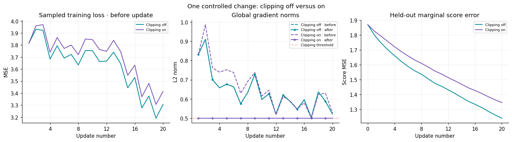

# Week 13 — Training Stability for the Score Toy

**Status:** Complete — experiment reviewed on 2026-10-13; consolidated after
the Session 8 discussion and question round on 2026-10-14.

**Question:** Does global gradient-norm clipping improve the learned score
under matched training conditions, or only bound the applied gradients?

## Hypothesis Before Running

Clipping will bound the applied global gradient norm at $0.5$. Smaller
steps might make training more stable and slightly reduce held-out score
MSE. However, they could also slow progress within a fixed 20-update budget.
This was the learner's prediction before seeing the comparison.

## Controlled Change

The [solved Week 13 notebook](../notebooks/w13_optimizers_sanity_solved.ipynb)
reuses the Week 8 direct-score MLP and Gaussian-blob data construction.
Only clipping changes: off versus a fixed global L2 norm threshold of $0.5$,
applied to all parameter gradients together after backpropagation and before
the optimizer step.

Both runs share:

- Plain SGD with learning rate $0.1$ and a 20-update budget on CPU.
- One model initialization and the same 1,200 training / 300 held-out split.
- Clean-data, split, and initialization seeds of $42$.
- Corruption standard deviation $\sigma=0.5$ and the exact same sequence of fresh training-noise draws, seeded with $43$.
- One fixed held-out noisy set, using a separate noise generator seeded with $44$.

The threshold was chosen during notebook preparation from the initial
gradient scale, approximately $0.83$, to make clipping observable. It was
not selected by comparing held-out fit.

Training matches the conditional Gaussian score target
$-(x_t-x_0)/\sigma^2=-\epsilon/\sigma$ for $x_t=x_0+\sigma\epsilon$.
Held-out evaluation compares the prediction with the analytical marginal
score of the noisy mixture. Its component standard deviation is
$\sqrt{0.5^2+0.5^2}$. Both MSE metrics average over examples and coordinates,
but their targets differ.

## Observations

The figure is exported from the notebook's saved output. Sampled training
loss is measured before each update, and held-out score MSE after each update.
The two norm measurements bracket clipping, both before the optimizer step.

| Condition | Clipped updates | Maximum raw norm | Maximum applied norm | Final held-out score MSE |
| --- | --- | --- | --- | --- |
| Clipping off | $0/20$ | $0.910351$ | $0.910351$ | $1.240304$ |
| Clipping on | $20/20$ | $0.986525$ | $0.500000$ | $1.345339$ |

Both start at held-out score MSE $1.869517$ and improve over the run.
The final sampled training loss is also lower without clipping:
$3.305659$ versus $3.414067$.

Clipping activates at every update in the on condition, bringing the applied
norm to approximately $0.5$. With clipping off, before and after norms are
identical, so their plotted curves overlap. Later raw gradients differ across
conditions because the parameter trajectories have diverged despite sharing
data and corruption draws.

## Interpretation

Clipping performed its mechanical function, but the clipped model had
**higher final held-out score MSE** under these conditions. The predicted
modest fit improvement was not supported by this run.

For plain SGD, the update norm is $\eta\|g_{\mathrm{applied}}\|_2$, so the
clipped update norm is at most approximately $0.1\times0.5=0.05$.
Smaller updates could explain slower progress within 20 steps. This is a
plausible explanation, not proof that a longer clipped run would reach
the same error. The unclipped norms remained finite; we did not demonstrate
recovery from exploding gradients.

## Limitations and a Future Comparison

This is one data, initialization, and corruption setup, with one learning
rate, one threshold, and a short update budget. It establishes the observed
ordering for this experiment, without establishing a general ranking of
clipping versus no clipping.

A future experiment could compare a small, predeclared learning-rate grid
with paired clipping-off/on runs at each rate, keeping the threshold and
all other conditions fixed. That would test whether a larger learning rate
helps the clipped model, with an unclipped control at the same rate.
This follow-up has not been run.

## Connection to Diffusion and the Diagnostic Checkpoint

Score-based diffusion needs a useful learned score field across noise
levels. Optimization affects that field, so bounding training gradients and
improving score accuracy are separate questions. Our toy tests training at
one fixed noise level; it does not test reverse-process sampling or generated
sample quality.

For a hypothetical unstable training run, the learner chose to inspect
gradient norms and the learning rate, then test a reduced learning rate
with matched initialization, data, corruption draws, optimizer, and budget.
The diagnostic compares loss spikes and held-out score MSE rather than
assuming every stochastic step must decrease the loss.

**Local evidence:** [reviewed notebook](../notebooks/w13_optimizers_sanity_solved.ipynb),
[Week 8 training loop](../mini_projects/checkpoint_02_toy_score_matching/train.py),
[analytical mixture score](../mini_projects/checkpoint_02_toy_score_matching/evaluate.py),
and [optimization notes](w13_optimization.md).
