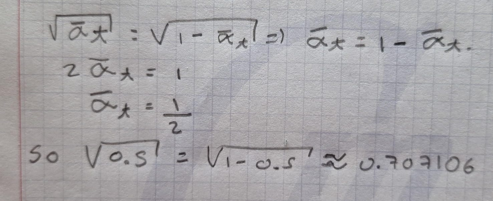

# Week 15 — The Discrete Forward Diffusion Process

**Status:** Day 1 completed and its note approved by the learner on
2026-10-30. Day 2 reading and discussion also completed on 2026-10-30;
the learner's read-through of the new Day 2 section is pending. The
closed-form derivation and notebook work remain for later days in the
[study plan](w15_study_plan.md).

**Day 1 reading:** [The Annotated Diffusion Model](https://huggingface.co/blog/annotated-diffusion),
the introductory explanation and the beginning of its mathematical section,
through the forward trajectory from $x_0$ to $x_T$. The reading stopped
before the reverse-conditional discussion. The explanations and numerical
example below consolidate our own discussion rather than quote the article.

## The Overall Picture

Like the generative models studied earlier, diffusion models generate a
data sample starting from noise drawn from a simple distribution. The
article takes a discrete-time perspective: a chosen forward process corrupts
data, while a learned reverse process generates by progressively denoising.

We start with a clean sample $x_0$ from the data distribution $q(x_0)$.
For images, the whole image can be treated as a vector. Forward steps
attenuate the previous image's signal and add Gaussian noise. This scaling
acts across pixel values; the image keeps its shape and number of pixels.

The number of steps $T$ is a design choice. The DDPM setup described in the
article uses $T=1000$.

## One-Step Gaussian Corruption

Choose a schedule with $0<\beta_t<1$. The article presents increasing
variances; the values are known in advance. At each step, draw fresh noise
independently of the previous state:

$$
\epsilon_t\sim\mathcal N(0,I),
\qquad
x_t=\sqrt{1-\beta_t}\,x_{t-1}+\sqrt{\beta_t}\,\epsilon_t.
$$

This gives the conditional distribution

$$
q(x_t\mid x_{t-1})
=\mathcal N\!\left(
x_t;\sqrt{1-\beta_t}\,x_{t-1},\beta_t I
\right).
$$

The transition is a modeling choice. Its conditional Gaussian law follows
from the affine transformation of standard Gaussian noise.

Given $x_{t-1}$ and $t$, the schedule and signal term are fixed. The fresh
noise draw supplies the randomness. The noise multiplier is
$\sqrt{\beta_t}$, so its covariance contribution is $\beta_t I$.

For the scalar example $x_{t-1}=2$ and $\beta_t=0.04$,

$$
x_t=2\sqrt{0.96}+0.2\epsilon,
\qquad \epsilon\sim\mathcal N(0,1),
$$

and therefore

$$
x_t\mid x_{t-1}=2
\sim\mathcal N\!\left(2\sqrt{0.96},0.04\right).
$$

The signal multiplier is $\sqrt{0.96}$; the entire deterministic term
also includes the given value $2$. The noise standard deviation is $0.2$,
and its variance is $0.04$.

## Conditional Gaussian Does Not Imply a Gaussian Marginal

The conditioning matters. Suppose the previous value is equally likely to
be $-2$ or $+2$, and write $m=\sqrt{0.96}$. The next value has density

$$
q_t(x)
=\tfrac12\mathcal N(x;2m,0.04)
+\tfrac12\mathcal N(x;-2m,0.04).
$$

Each starting value gives a Gaussian conditional distribution. Across both
starting values, we have a mixture with two peaks near $-2m$ and $+2m$.
This example shows why Gaussian corruption does not automatically make the
whole noisy-data distribution Gaussian.

Here we choose a component and sample from it. The formula adds weighted
**densities**. A weighted sum of independent Gaussian **random variables**
would be a different construction and would remain Gaussian.

## What Happens at the Endpoint?

My corrected understanding: after finitely many steps, some contribution
from $x_0$ remains, scaled down by the signal multipliers. With a suitable
schedule and enough steps, that contribution becomes very small. For
general image data, the intended endpoint is therefore approximately
standard Gaussian noise. The size of the remaining signal depends on the
whole schedule and the number of steps.

The thought experiment $\beta_T=1$ would make the final signal multiplier
zero and give $x_T=\epsilon_T$ exactly. This lies outside the schedule
constraint $0<\beta_t<1$ used above.

Day 2 will study how to express the accumulated signal and noise directly
from $x_0$; the derivation belongs to Day 3.

## Day 1 Discussion Record

- The initial explanation correctly distinguished the chosen schedule from
  the randomness of each noise draw and identified the conditional mean
  and covariance.
- Codex restored the missing square roots in the pasted sampling equation.
  In the scalar check, the learner identified both multipliers correctly
  and included the factor $x_{t-1}=2$ after a hint.
- In the prompted two-starting-value example, the learner correctly
  identified an equal-weight Gaussian mixture and its two-peak shape.
  Codex clarified conditional versus marginal distributions and a mixture
  of densities versus a sum of Gaussian random variables.
- After the endpoint question, the learner correctly explained that some
  scaled contribution from $x_0$ remains. Codex qualified the approximation
  as depending on sufficient accumulated signal attenuation.

The reading, guided discussion, and learner's read-through are complete.
The learner approved this cleaned note on 2026-10-30. Later derivations and
numerical checks have not yet been attempted.

## Day 2 — Direct Sampling from the Clean Image

**Reading:** The direct-noising passage in
[Annotated Diffusion](https://huggingface.co/blog/annotated-diffusion#defining-an-objective-function-by-reparametrizing-the-mean),
and the later corruption subsection within
[HF Unit 1's DDPM comparison](https://huggingface.co/learn/diffusion-course/en/unit1/3#comparison-to-ddpm).
The selected passages and discussion were completed on 2026-10-30. The
formula below was read and interpreted; its derivation remains for Day 3.

### One Step Versus Accumulated Corruption

Define

$$
\alpha_t:=1-\beta_t,
\qquad
\bar\alpha_t:=\prod_{s=1}^{t}\alpha_s.
$$

The individual $\alpha_t$ describes the current step. The product
$\bar\alpha_t$ accounts for all the steps from the clean input to the
chosen time. Knowing only $\beta_t=0.01$ tells me $\alpha_t=0.99$, but
generally does not tell me how much of $x_0$ remains. I also need the
earlier schedule values, or the already computed product. At $t=1$,
$\bar\alpha_1=\alpha_1$, so that special case needs only the first value.

### The Direct Conditional Distribution

Instead of simulating every intermediate step, I can sample the endpoint
at a chosen time directly from

$$
q(x_t\mid x_0)
=\mathcal N\!\left(
x_t;\sqrt{\bar\alpha_t}\,x_0,(1-\bar\alpha_t)I
\right).
$$

Equivalently, draw $\epsilon\sim\mathcal N(0,I)$ independently of $x_0$
and set

$$
x_t=\sqrt{\bar\alpha_t}\,x_0
+\sqrt{1-\bar\alpha_t}\,\epsilon.
$$

The signal multiplier is $\sqrt{\bar\alpha_t}$ and the noise multiplier
is $\sqrt{1-\bar\alpha_t}$. Given $x_0$, the covariance is
$(1-\bar\alpha_t)I$, without a square root. The product defining
$\bar\alpha_t$ ends at the chosen $t$. These distinctions correct the
notation slips in the HF course passage.

### Reading the Coefficient Plot

The course plot shows the signal multiplier decreasing while the noise
multiplier increases. These are amplitudes. Their squares add to one:

$$
\left(\sqrt{\bar\alpha_t}\right)^2
+\left(\sqrt{1-\bar\alpha_t}\right)^2=1.
$$

My handwritten crossing calculation sets the two coefficients equal:

$$
\sqrt{\bar\alpha_t}=\sqrt{1-\bar\alpha_t}
\quad\Longrightarrow\quad
\bar\alpha_t=1-\bar\alpha_t
\quad\Longrightarrow\quad
\bar\alpha_t=\frac12.
$$

At the crossing, each multiplier is $1/\sqrt2\approx0.7071$, matching
the plot. The conditional noise covariance there is $0.5I$.

The original handwritten attempt is preserved above; the typeset version
records the same reasoning.

### What Agreement Between the Two Methods Means

Even two direct samples can differ because they use different noise draws.
Sequential sampling draws fresh noise at every step; direct sampling uses
one noise draw to produce the chosen endpoint. Separately sampled runs
therefore need not match pixel for pixel.

For fixed $x_0$ and $t$, both methods have the same full conditional
distribution $q(x_t\mid x_0)$. Equal conditional means and covariances are
consequences of that agreement. Across different clean images, the
marginal distribution still need not be Gaussian.

Codex noted that the weighted independent Gaussian noise terms in the
sequential construction combine into an effective Gaussian noise term.
Day 3 will derive its coefficient and establish the closed form explicitly.

### Normalization in the Image Experiment

For an original pixel value $u\in[0,1]$, the transformation $x=2u-1$
maps its range to $[-1,1]$. This centers the pixel range around zero and
sets the image scale relative to the standard Gaussian noise. It does not
guarantee zero dataset mean, unit variance, or Gaussian image data.

The forward equations apply with either scaling, but the image's scale
affects the balance between signal and noise. Corrupted values can extend
beyond $[-1,1]$. The notebook will record its normalization and keep
display clipping separate from the values used in calculations.

### Day 2 Discussion Record

- The initial reading summary correctly stated both schedule definitions,
  the direct conditional law, and the sampling equation, including the
  covariance-versus-noise-multiplier distinction.
- In the first check, the learner correctly explained why the current
  $\beta_t$ alone is insufficient and identified the $t=1$ exception.
- In the second check, the learner supplied the handwritten derivation
  $\bar\alpha_t=1/2$ and both coefficients approximately $0.7071$.
  Codex confirmed the calculation and identified the conditional noise
  covariance as $0.5I$.
- In the final check, the learner correctly explained why separately
  sampled endpoints can differ and that the two constructions agree in
  distribution. Codex made the conditioning on $x_0$ explicit and noted
  that the agreement is stronger than matching a few moments.
- Codex explained the normalization convention in response to the
  learner's question. It has not yet been applied in the weekly experiment.

The Day 2 reading and discussion are complete. The learner's read-through
of this new section is pending. The full derivation and numerical
verification remain for Days 3–5.
