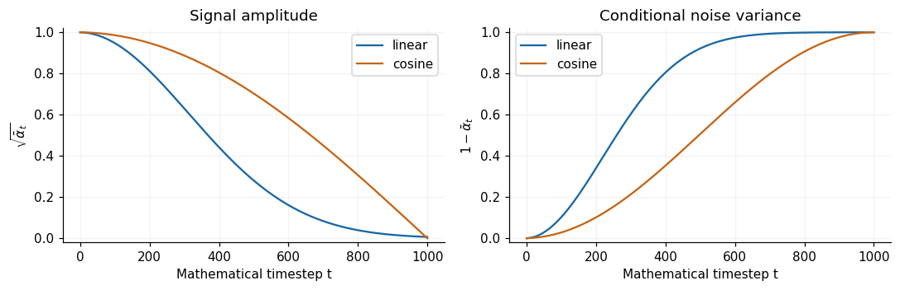
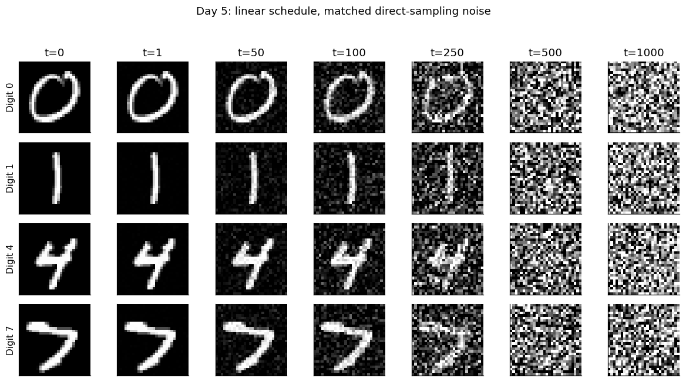
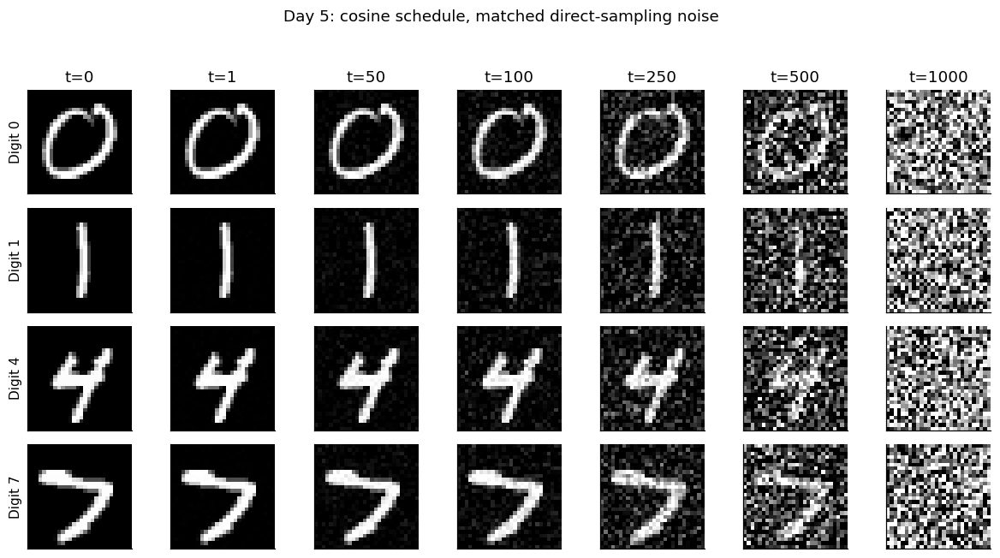
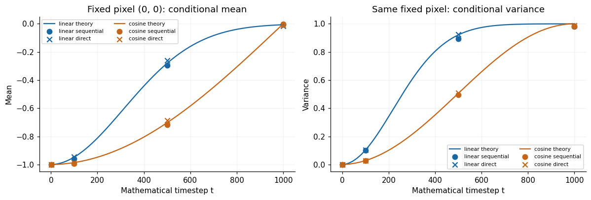

# Week 15 — The Discrete Forward Diffusion Process

**Status:** Week 15 completed on 2026-11-05 after the final discussion and
Juan's request to consolidate and close the week. Day 1 completed and its
note was approved by the learner on
2026-10-30. Day 2 reading and discussion completed on 2026-10-30; Day 3's
handwritten derivation and guided review completed on 2026-11-02. The
learner read and approved the Day 2 and Day 3 sections on 2026-11-02,
completing Days 1–3.
Day 4's notebook implementation and observation discussion completed on
2026-11-03; the learner read and approved the Day 4 note and notebook
observations on the same date, completing Days 1–4.
Day 5 completed on 2026-11-04: the schedule comparison, Monte Carlo code,
discussion, and learner approval of the cleaned note and notebook
observations are complete. Day 6's explanation, evidence discussion,
learner questions, and final consolidation completed on 2026-11-05;
the [study plan](w15_study_plan.md) records the completion decision.

**Day 1 reading:** [The Annotated Diffusion Model](https://huggingface.co/blog/annotated-diffusion),
the introductory explanation and the beginning of its mathematical section,
through the forward trajectory from $x_0$ to $x_T$. The reading stopped
before the reverse-conditional discussion. The explanations and numerical
example below consolidate our own discussion rather than quote the article.

## The Overall Picture

Like the generative models studied earlier, diffusion models generate a
data sample starting from noise drawn from a simple distribution. The
article takes a discrete-time perspective: a chosen forward process corrupts
data, while a learned reverse process generates by progressively denoising.

We start with a clean sample $x_0$ from the data distribution $q(x_0)$.
For images, the whole image can be treated as a vector. Forward steps
attenuate the previous image's signal and add Gaussian noise. This scaling
acts across pixel values; the image keeps its shape and number of pixels.

The number of steps $T$ is a design choice. The DDPM setup described in the
article uses $T=1000$.

## One-Step Gaussian Corruption

Choose a schedule with $0<\beta_t<1$. The article presents increasing
variances; the values are known in advance. At each step, draw fresh noise
independently of the previous state:

$$
\epsilon_t\sim\mathcal N(0,I),
\qquad
x_t=\sqrt{1-\beta_t}\,x_{t-1}+\sqrt{\beta_t}\,\epsilon_t.
$$

This gives the conditional distribution

$$
q(x_t\mid x_{t-1})
=\mathcal N\!\left(
x_t;\sqrt{1-\beta_t}\,x_{t-1},\beta_t I
\right).
$$

The transition is a modeling choice. Its conditional Gaussian law follows
from the affine transformation of standard Gaussian noise.

Given $x_{t-1}$ and $t$, the schedule and signal term are fixed. The fresh
noise draw supplies the randomness. The noise multiplier is
$\sqrt{\beta_t}$, so its covariance contribution is $\beta_t I$.

For the scalar example $x_{t-1}=2$ and $\beta_t=0.04$,

$$
x_t=2\sqrt{0.96}+0.2\epsilon,
\qquad \epsilon\sim\mathcal N(0,1),
$$

and therefore

$$
x_t\mid x_{t-1}=2
\sim\mathcal N\!\left(2\sqrt{0.96},0.04\right).
$$

The signal multiplier is $\sqrt{0.96}$; the entire deterministic term
also includes the given value $2$. The noise standard deviation is $0.2$,
and its variance is $0.04$.

## Conditional Gaussian Does Not Imply a Gaussian Marginal

The conditioning matters. Suppose the previous value is equally likely to
be $-2$ or $+2$, and write $m=\sqrt{0.96}$. The next value has density

$$
q_t(x)
=\tfrac12\mathcal N(x;2m,0.04)
+\tfrac12\mathcal N(x;-2m,0.04).
$$

Each starting value gives a Gaussian conditional distribution. Across both
starting values, we have a mixture with two peaks near $-2m$ and $+2m$.
This example shows why Gaussian corruption does not automatically make the
whole noisy-data distribution Gaussian.

Here we choose a component and sample from it. The formula adds weighted
**densities**. A weighted sum of independent Gaussian **random variables**
would be a different construction and would remain Gaussian.

## What Happens at the Endpoint?

My corrected understanding: after finitely many steps, some contribution
from $x_0$ remains, scaled down by the signal multipliers. With a suitable
schedule and enough steps, that contribution becomes very small. For
general image data, the intended endpoint is therefore approximately
standard Gaussian noise. The size of the remaining signal depends on the
whole schedule and the number of steps.

The thought experiment $\beta_T=1$ would make the final signal multiplier
zero and give $x_T=\epsilon_T$ exactly. This lies outside the schedule
constraint $0<\beta_t<1$ used above.

Day 2 below expresses the accumulated signal and noise directly from
$x_0$; Day 3 provides the derivation.

## Day 1 Discussion Record

- The initial explanation correctly distinguished the chosen schedule from
  the randomness of each noise draw and identified the conditional mean
  and covariance.
- Codex restored the missing square roots in the pasted sampling equation.
  In the scalar check, the learner identified both multipliers correctly
  and included the factor $x_{t-1}=2$ after a hint.
- In the prompted two-starting-value example, the learner correctly
  identified an equal-weight Gaussian mixture and its two-peak shape.
  Codex clarified conditional versus marginal distributions and a mixture
  of densities versus a sum of Gaussian random variables.
- After the endpoint question, the learner correctly explained that some
  scaled contribution from $x_0$ remains. Codex qualified the approximation
  as depending on sufficient accumulated signal attenuation.

The reading, guided discussion, and learner's read-through are complete.
The learner approved this cleaned note on 2026-10-30. At that point, the
later derivations and numerical checks had not yet been attempted.

## Day 2 — Direct Sampling from the Clean Image

**Reading:** The direct-noising passage in
[Annotated Diffusion](https://huggingface.co/blog/annotated-diffusion#defining-an-objective-function-by-reparametrizing-the-mean),
and the later corruption subsection within
[HF Unit 1's DDPM comparison](https://huggingface.co/learn/diffusion-course/en/unit1/3#comparison-to-ddpm).
The selected passages and discussion were completed on 2026-10-30. The
formula below was read and interpreted; its derivation is recorded in Day 3.

### One Step Versus Accumulated Corruption

Define

$$
\alpha_t:=1-\beta_t,
\qquad
\bar\alpha_t:=\prod_{s=1}^{t}\alpha_s.
$$

The individual $\alpha_t$ describes the current step. The product
$\bar\alpha_t$ accounts for all the steps from the clean input to the
chosen time. Knowing only $\beta_t=0.01$ tells me $\alpha_t=0.99$, but
generally does not tell me how much of $x_0$ remains. I also need the
earlier schedule values, or the already computed product. At $t=1$,
$\bar\alpha_1=\alpha_1$, so that special case needs only the first value.

### The Direct Conditional Distribution

Instead of simulating every intermediate step, I can sample the endpoint
at a chosen time directly from

$$
q(x_t\mid x_0)
=\mathcal N\!\left(
x_t;\sqrt{\bar\alpha_t}\,x_0,(1-\bar\alpha_t)I
\right).
$$

Equivalently, draw $\epsilon\sim\mathcal N(0,I)$ independently of $x_0$
and set

$$
x_t=\sqrt{\bar\alpha_t}\,x_0
+\sqrt{1-\bar\alpha_t}\,\epsilon.
$$

The signal multiplier is $\sqrt{\bar\alpha_t}$ and the noise multiplier
is $\sqrt{1-\bar\alpha_t}$. Given $x_0$, the covariance is
$(1-\bar\alpha_t)I$, without a square root. The product defining
$\bar\alpha_t$ ends at the chosen $t$. These distinctions correct the
notation slips in the HF course passage.

### Reading the Coefficient Plot

The course plot shows the signal multiplier decreasing while the noise
multiplier increases. These are amplitudes. Their squares add to one:

$$
\left(\sqrt{\bar\alpha_t}\right)^2
+\left(\sqrt{1-\bar\alpha_t}\right)^2=1.
$$

My handwritten crossing calculation sets the two coefficients equal:

$$
\sqrt{\bar\alpha_t}=\sqrt{1-\bar\alpha_t}
\quad\Longrightarrow\quad
\bar\alpha_t=1-\bar\alpha_t
\quad\Longrightarrow\quad
\bar\alpha_t=\frac12.
$$

At the crossing, each multiplier is $1/\sqrt2\approx0.7071$, matching
the plot. The conditional noise covariance there is $0.5I$.

The original handwritten attempt is preserved above; the typeset version
records the same reasoning.

### What Agreement Between the Two Methods Means

Even two direct samples can differ because they use different noise draws.
Sequential sampling draws fresh noise at every step; direct sampling uses
one noise draw to produce the chosen endpoint. Separately sampled runs
therefore need not match pixel for pixel.

For fixed $x_0$ and $t$, both methods have the same full conditional
distribution $q(x_t\mid x_0)$. Equal conditional means and covariances are
consequences of that agreement. Across different clean images, the
marginal distribution still need not be Gaussian.

Codex noted that the weighted independent Gaussian noise terms in the
sequential construction combine into an effective Gaussian noise term.
Day 3 below derives its coefficient and establishes the closed form explicitly.

### Normalization in the Image Experiment

For an original pixel value $u\in[0,1]$, the transformation $x=2u-1$
maps its range to $[-1,1]$. This centers the pixel range around zero and
sets the image scale relative to the standard Gaussian noise. It does not
guarantee zero dataset mean, unit variance, or Gaussian image data.

The forward equations apply with either scaling, but the image's scale
affects the balance between signal and noise. Corrupted values can extend
beyond $[-1,1]$. The notebook will record its normalization and keep
display clipping separate from the values used in calculations.

### Day 2 Discussion Record

- The initial reading summary correctly stated both schedule definitions,
  the direct conditional law, and the sampling equation, including the
  covariance-versus-noise-multiplier distinction.
- In the first check, the learner correctly explained why the current
  $\beta_t$ alone is insufficient and identified the $t=1$ exception.
- In the second check, the learner supplied the handwritten derivation
  $\bar\alpha_t=1/2$ and both coefficients approximately $0.7071$.
  Codex confirmed the calculation and identified the conditional noise
  covariance as $0.5I$.
- In the final check, the learner correctly explained why separately
  sampled endpoints can differ and that the two constructions agree in
  distribution. Codex made the conditioning on $x_0$ explicit and noted
  that the agreement is stronger than matching a few moments.
- Codex explained the normalization convention in response to the
  learner's question. It has not yet been applied in the weekly experiment.

The Day 2 reading and discussion are complete. The learner read and
approved this section on 2026-11-02. The derivation follows below; numerical
verification remains for Days 4–5.

## Day 3 — Deriving the Forward Distributions

**Basis:** The learner's handwritten attempt and our guided review on
2026-11-02. This is a consolidation of that derivation, rather than an
attributed solution from either reading. The original pages and assistance
used are recorded below. The learner read and approved this cleaned
section on 2026-11-02.

### Setup and the One-Step Law

Use a deterministic schedule with $0<\beta_t<1$,
$\alpha_t=1-\beta_t$, and $\bar\alpha_t=\prod_{s=1}^{t}\alpha_s$.
All fresh noise vectors $\epsilon_s\sim\mathcal N(0,I)$ are mutually
independent and independent of $x_0$. The step is

$$
x_t=\sqrt{\alpha_t}\,x_{t-1}+\sqrt{\beta_t}\,\epsilon_t.
$$

Given $x_{t-1}$, the first term is fixed, the noise has zero mean and
covariance $I$, and the affine transformation is Gaussian. Hence

$$
\begin{aligned}
\mathbb E[x_t\mid x_{t-1}]&=\sqrt{\alpha_t}\,x_{t-1},\\
\operatorname{Cov}(x_t\mid x_{t-1})&=\beta_t I,
\end{aligned}
$$

which establishes the chosen one-step Gaussian kernel.

### Expand Two Steps

Substitute the first step into the second:

$$
\begin{aligned}
x_1&=\sqrt{\alpha_1}\,x_0+\sqrt{\beta_1}\,\epsilon_1,\\
x_2&=\sqrt{\alpha_2}\,x_1+\sqrt{\beta_2}\,\epsilon_2\\
&=\sqrt{\alpha_1\alpha_2}\,x_0
+\sqrt{\alpha_2\beta_1}\,\epsilon_1
+\sqrt{\beta_2}\,\epsilon_2.
\end{aligned}
$$

Given $x_0$, its term is a fixed shift. Independence from $x_0$ gives
$\mathbb E[\epsilon_1\mid x_0]=\mathbb E[\epsilon_2\mid x_0]=0$.
By linearity,

$$
\mathbb E[x_2\mid x_0]
=\sqrt{\alpha_1\alpha_2}\,x_0.
$$

For the covariance, the fixed shift contributes zero and independence
eliminates the cross-covariance terms. Squaring the noise multipliers gives

$$
\begin{aligned}
\operatorname{Cov}(x_2\mid x_0)
&=(\alpha_2\beta_1+\beta_2)I\\
&=\bigl[\alpha_2(1-\alpha_1)+(1-\alpha_2)\bigr]I\\
&=(1-\alpha_1\alpha_2)I\\
&=(1-\bar\alpha_2)I.
\end{aligned}
$$

The learner's Gaussianity argument: after conditioning on $x_0$, we have
a fixed shift plus two scaled independent Gaussian vectors. Together the
noise vectors are jointly Gaussian, and their affine combination remains
Gaussian. The calculated moments therefore identify the full conditional
law:

$$
x_2\mid x_0
\sim\mathcal N\!\left(
\sqrt{\bar\alpha_2}\,x_0,(1-\bar\alpha_2)I
\right).
$$

### Generalize by Induction

The one-step law supplies the base case. Assume that, at time $t-1$,

$$
x_{t-1}\mid x_0
\sim\mathcal N\!\left(
\sqrt{\bar\alpha_{t-1}}\,x_0,
(1-\bar\alpha_{t-1})I
\right).
$$

Apply one more step with fresh independent noise. Its conditional mean is

$$
\begin{aligned}
\mathbb E[x_t\mid x_0]
&=\sqrt{\alpha_t}\,\mathbb E[x_{t-1}\mid x_0]\\
&=\sqrt{\alpha_t\bar\alpha_{t-1}}\,x_0\\
&=\sqrt{\bar\alpha_t}\,x_0.
\end{aligned}
$$

The new noise is independent of the entire previous history and of $x_0$,
so the conditional covariance is

$$
\begin{aligned}
\operatorname{Cov}(x_t\mid x_0)
&=\alpha_t\operatorname{Cov}(x_{t-1}\mid x_0)+\beta_t I\\
&=\bigl[\alpha_t(1-\bar\alpha_{t-1})+\beta_t\bigr]I\\
&=(1-\alpha_t\bar\alpha_{t-1})I\\
&=(1-\bar\alpha_t)I.
\end{aligned}
$$

Gaussianity follows from the same affine-Gaussian argument. This completes
the induction and establishes, for $t\geq1$,

$$
q(x_t\mid x_0)
=\mathcal N\!\left(
x_t;\sqrt{\bar\alpha_t}\,x_0,(1-\bar\alpha_t)I
\right).
$$

Thus we can generate a direct sample at the chosen time using a standard
Gaussian vector:

$$
x_t=\sqrt{\bar\alpha_t}\,x_0
+\sqrt{1-\bar\alpha_t}\,\epsilon,
\qquad\epsilon\sim\mathcal N(0,I).
$$

This direct representation has the same conditional law as the sequential
endpoint. A separately drawn $\epsilon$ need not reproduce the endpoint
of a particular previously sampled trajectory.

### Boundary Checks

At $t=1$, $\bar\alpha_1=\alpha_1=1-\beta_1$. The direct formula becomes

$$
x_1=\sqrt{1-\beta_1}\,x_0+\sqrt{\beta_1}\,\epsilon_1,
$$

recovering the original one-step construction and its conditional law.

At $t=0$, use the empty-product convention $\bar\alpha_0=1$. The signal
multiplier is one and the noise multiplier is zero, so the formula returns
$x_0$ exactly. Its covariance conditional on $x_0$ is the zero matrix.
The conditional law is a point mass at the observed clean image; there is
no ordinary nondegenerate Gaussian density at this boundary. Before
conditioning, a clean sample can still be random under the data
distribution $q(x_0)$.

### Original Handwritten Pages

All five supplied pages are preserved unchanged, including the initial
notation and subsequent correction:

1. [Two-step substitution and expansion](figures/w15_two_step_expansion_handwritten.png).
2. [Initial conditional mean and covariance calculation](figures/w15_two_step_moments_initial_handwritten.png).
3. [Covariance simplification with the identity matrix retained](figures/w15_two_step_covariance_handwritten.png).
4. [Induction step](figures/w15_forward_induction_handwritten.png).
5. [Boundary checks](figures/w15_forward_boundaries_handwritten.png).

### Day 3 Review Record

The independent attempt exceeded the suggested 15–20-minute starting
budget; no exact duration was recorded. The learner brought the unfinished
work for review after correctly expanding two steps, calculating the
conditional mean, and obtaining the covariance coefficient
$\alpha_2\beta_1+\beta_2$.

- Codex pointed out the missing $I$ in the final vector covariance. The
  learner included it on the next page.
- Codex prompted substitution of $\beta_s=1-\alpha_s$. The learner
  correctly simplified the covariance to $(1-\bar\alpha_2)I$.
- Asked to justify Gaussianity, the learner correctly explained the fixed
  shift and scaled independent Gaussian noise terms.
- Codex supplied the induction hypothesis as a scaffold. The learner
  correctly obtained the general conditional mean, covariance, and law.
  Codex then supplied the intermediate covariance recurrence to make the
  independence and scaling explicit.
- With the two boundary checks prompted and the empty-product convention
  supplied, the learner correctly recovered the first step and explained
  the absence of conditional uncertainty at $t=0$. Codex clarified the
  distinction from randomness in the unconditioned dataset.

The derivation and guided review are complete on 2026-11-02. This records
correct reasoning with the assistance above, rather than a fully unaided
proof. The learner read and approved this cleaned section and the earlier
Day 2 section on 2026-11-02. Numerical verification remains for Days 4–5.

## Day 4 — Implementing and Interpreting Forward Noising

**Status:** Day 4 completed on 2026-11-03, including the learner's approval
of this note and the notebook's consolidated observations. This
section consolidates Juan's answers and our subsequent discussion. The
corrections and added explanations are recorded below.

**Evidence:** The completed
[working notebook](../notebooks/w15_forward_diffusion_mnist_solved.ipynb)
implements the schedule coefficients, one-step corruption, and direct
sampling. Codex checked the implementations and executed all 16 code cells
in a fresh namespace on the cached MNIST data. All supplied assertions
passed, including the clean boundary, first step, two-step formula,
per-image broadcasting, finite shapes, and preservation of raw values.

The run uses NumPy on CPU, seed 15, $T=1000$, and a linear schedule from
$\beta_1=10^{-4}$ to $\beta_T=0.02$. It selects digits 0, 1, 4, and 7,
maps their pixels to $[-1,1]$, and displays times 0, 1, 50, 100, 250, 500,
and 1000. Sequential and direct plots use separate seeded noise streams.

### Boundary and Scale

My $t=0$ result shows the clean image $x_0$: the signal multiplier is one
and the noise multiplier is zero.

For each standard-normal noise coordinate, about 68% of draws lie within
$[-1,1]$, but the distribution has unbounded support. Nothing guarantees
that every noise value stays in that range. Adding a scaled noise value
to a scaled clean pixel can therefore produce a result outside the
normalized image range.

The saved run illustrates this: terminal raw values range approximately
from $-3.32$ to $3.70$ in the sequential sample and from $-3.45$ to $3.76$
in the direct sample. Plotting clips a copy for display; the arrays used
for calculations retain these raw values.

### Curves and Images at an Intermediate Time

At $t=100$, I can still recognize the four digits despite visible noise.
The recorded coefficients give

$$
x_{100}\approx0.9471\,x_0+0.3209\,\epsilon.
$$

The signal coefficient is close to one, so rescaling the clean pixel values
preserves much of the visible structure. Every clean pixel is multiplied
by that coefficient. The noise coefficient scales each corresponding
noise draw: a draw of $1$ contributes about $0.3209$, while a draw of $0.1$
contributes about $0.03209$. Signed noise can raise or lower a pixel value.

The conditional noise variance per coordinate is
$0.3209^2\approx0.10298$. My initial interpretation described this as
roughly 10% noise and 90% image. The correction is that conditional variance
is not a percentage of the image or an amplitude weight.

**Clarification added during review:** Given a fixed $x_0$, the signal
term is deterministic and all conditional variance comes from the noise.
Across different clean images, the relative contributions to marginal
variance also depend on the clean-data covariance. Mapping the pixel range
to $[-1,1]$ does not impose unit data variance.

I also briefly mixed the direct formula with an update from $x_{99}$.
The corrected single-step expression is

$$
x_{100}=\sqrt{1-\beta_{100}}\,x_{99}
+\sqrt{\beta_{100}}\,\epsilon_{100},
$$

whereas the direct formula starts from $x_0$ and uses the cumulative
coefficient $\bar\alpha_{100}$.

### Two Constructions and the Numerical Check Still Ahead

The sequential and direct grids show similar qualitative corruption and
both recover the clean images at $t=0$. For the same fixed $x_0$ and $t$,
they sample from the same conditional distribution established on Day 3.
Their conditional means and covariances therefore agree, even though
independently generated samples need not match pixel by pixel.

I initially suggested checking the proof mathematically and comparing
pixel-by-pixel differences. The proof already establishes the theoretical
agreement. Pixel differences between individual independent draws do not
test whether the two implementations sample the same distribution.

After discussing what numerical evidence would help, I proposed a Monte
Carlo approximation: make many draws, for example 100, record them, and
estimate their mean and variance. The planned Day 5 check fixes a clean
coordinate $x_{0,j}$ and a timestep, repeats each sampling construction,
and compares its empirical moments with

$$
\mu_{t,j}=\sqrt{\bar\alpha_t}\,x_{0,j},
\qquad
v_{t,j}=1-\bar\alpha_t.
$$

**Clarification added by Codex:** Estimate variance across the individual
draws around their sample mean. Keep the clean input and timestep fixed;
averaging different pixels or images estimates a different quantity.
Sampling error is expected with 100 draws, and a larger sample makes the
comparison more precise. This check has been proposed, not yet run in the
weekly experiment. It will test implementation behavior against the
derived law; the four pictures alone do not establish that agreement.

The figures above are copies of the saved Day 4 notebook figures under
the ignored scratch directory. The fresh execution reproduced the checks,
coefficient values, and reported raw terminal ranges.

### Day 4 Review Record

- Juan completed all three implementation exercises correctly. The saved
  outputs and the fresh execution passed all provided checkpoints.
- The original boundary and Gaussian-support explanation was correct.
  Codex clarified that the 68% statement applies to an individual standard
  Gaussian noise coordinate.
- The coefficients at $t=100$ were identified correctly, but interpreting
  the variance as a percentage needed correction. Codex also clarified
  that every clean pixel is rescaled and that noise can raise or lower its
  value. Juan correctly rewrote the single-step formula and distinguished
  its $x_{99}$ input from direct sampling's $x_0$.
- With a prompt to fix a clean pixel and timestep, Juan proposed repeated
  sampling and Monte Carlo moment estimates. Codex clarified the variance
  calculation and the role of sampling error. The empirical comparison
  remains for Day 5, alongside the second schedule.

Day 4 is complete on 2026-11-03, including learner read-through and approval
of the cleaned note and the notebook's final observation cells. This
records correct code and understanding reached through review; it does not
claim that all initial interpretations were correct. Day 5's second
schedule and Monte Carlo experiment remain ahead.

## Day 5 — Comparing Schedules and Checking Conditional Moments

**Status:** Day 5 completed on 2026-11-04, including Juan's read-through
and approval of this section and the notebook's consolidated observations.
The first-person observations preserve his interpretation; added
explanations and corrections are identified below.

**Evidence:** Juan completed the conditional-target and moment-estimator
exercises in the [working notebook](../notebooks/w15_forward_diffusion_mnist_solved.ipynb).
A fresh execution of all 27 code cells passed every supplied assertion,
including 16 schedule/method/time Monte Carlo cases and 32 coordinate-level
mean/variance pairs. This validates the learner's actual code, separately
from the temporary reference answers used during preparation.

The run retains the Day 4 data, normalization, root seed 15, and $T=1000$.
It compares the linear schedule with a cosine schedule using offset
$s=0.008$ and beta clipping bounds $[10^{-4},0.9999]$. Cumulative products
are recomputed after clipping. The visual comparison uses the same clean
digits and matched Gaussian noise, with seed 45. Moment checks use 4,000
repetitions at times 1, 100, 500, and 1000; sequential and direct sampling
use separate streams seeded 65 and 66.

### Schedules at the Same Timestep

At $t=500$, the linear images look unrecognizable to me, while the cosine
images are very noisy but still retain some recognizable patterns.

| Schedule | Signal amplitude | Conditional variance | My observation at $t=500$ |
| --- | --- | --- | --- |
| Linear | 0.280334 | 0.921413 | Looks like noise; I cannot recognize the digits |
| Cosine | 0.702605 | 0.506346 | Very noisy, but some original patterns remain |

The schedules give different image and noise multipliers at the same
timestep. Here the cosine schedule has a higher signal amplitude and a
lower noise amplitude. The timestep label alone does not determine the
corruption level: the cumulative product $\bar\alpha_t$ depends on the
schedule through that point. Conditional variance remains a variance per
coordinate, not a percentage of the image.

These direct snapshots compare schedules at selected times; they are not
a sampled sequential trajectory. Recognizability is my observation of
these selected digits and draws.

### A Fixed-Coordinate Monte Carlo Comparison

I selected coordinate index 1 of the two-coordinate vector: pixel $(5,18)$
of the selected digit 0, with clean value $x_{0,j}=1$. For the cosine
schedule at $t=100$, the recorded results are:

| Quantity | Target | Sequential estimate | Direct estimate |
| --- | --- | --- | --- |
| Mean | 0.9857581658 | 0.9852260469 | 0.9863694586 |
| Variance | 0.0282808385 | 0.0274859649 | 0.0290450329 |

My initial answer described these estimates as close by comparing decimal
places. After Codex supplied the standard error of the sample mean, I
compared each discrepancy with that scale: sequential is about 0.20 SE
from its target and direct about 0.23 SE. Both are within one SE, so these
differences are consistent with the sampling variation we expect.

**Quantitative explanation added by Codex:** For $N=4000$ independent
Gaussian draws with variance $v=0.0282808385$, the estimator standard errors
are

$$
\operatorname{SE}(\hat\mu)=\sqrt{\frac{v}{N}}\approx0.002659,
\qquad
\operatorname{SE}(\hat v)=v\sqrt{\frac{2}{N-1}}\approx0.00063246.
$$

| Method | Mean error / SE | Variance error / SE |
| --- | --- | --- |
| Sequential | -0.200 | -1.257 |
| Direct | +0.230 | +1.208 |

The variance discrepancies are about 1.26 and 1.21 of their own standard
errors, also consistent with sampling variation. An estimate need not
fall within one SE. The notebook uses a broad six-SE diagnostic tolerance;
passing it is numerical evidence, not a proof of implementation correctness.
Increasing $N$ reduces the expected sampling error, without guaranteeing
that every particular estimate gets closer to its target.

Across all 16 cases, the largest absolute standardized errors were 2.913
for means, 1.649 for variances, and 1.369 for off-diagonal covariance. The
diagnostic table reports maxima over both coordinates; its row values
therefore need not equal the coordinate-1 errors above.

The moment plot displays coordinate index 0, pixel $(0,0)$ with clean value
$-1$. My worked numerical example above uses coordinate index 1.

### What the Evidence Supports

The checks support that sequential and direct sampling reproduce the
predicted conditional moments within Monte Carlo error in the tested
settings. They also check the clean boundary, array shapes, and the
expected zero cross-covariance between the two fixed noisy coordinates.
The conditional law was derived on Day 3; these finite checks provide
implementation evidence and do not establish every distributional or
trajectory property.

My conclusion about training was correct: these experiments do not tell
us which schedule generates better images after training. For these
schedules, the cosine images retain more visible structure at $t=500$.
No denoiser was trained and no reverse sampling was evaluated.

### Day 5 Review Record

- Juan correctly implemented both exercises and reported the observed
  schedule differences and selected empirical moments.
- Codex prompted interpretation relative to the mean estimator's standard
  error. Juan correctly identified both mean discrepancies as within one
  SE and consistent with expected sampling variation. Direct's rounded
  value is 0.23 SE.
- Codex added the variance-error interpretation and distinguished
  per-coordinate errors from the two-coordinate diagnostic maxima.
- Codex corrected the method names from "sequential and linear" to
  "sequential and direct" and scoped the recognizability claim to the
  observed schedules and images. Juan had already distinguished the
  forward comparison from evidence about trained generation quality.

The four figures are unchanged copies of the learner's saved Day 5 plots
under the ignored scratch directory. The raw 32-row CSV remains there as
`scratch/w15_forward_diffusion/figures/day5_mc_results.csv`. Juan read and
approved the cleaned note and notebook on 2026-11-04, completing Day 5.
The Day 6 record below contains the subsequent whole-process explanation
and final consolidation.

## Day 6 — Consolidating the Forward Process and Closing Week 15

**Status:** Completed on 2026-11-05. Juan concluded his questions and
explicitly requested consolidation, Week 15 completion, and commit/push.
His opening explanation was explicitly without notes; the later discussion
reused saved evidence. Added explanations are identified below.

### My Forward-Process Explanation

The forward process starts from a clean dataset sample $x_0$ and corrupts
it through incremental Gaussian steps. Our chosen setup has $T=1000$:

$$
x_t=\sqrt{1-\beta_t}\,x_{t-1}+\sqrt{\beta_t}\,\epsilon_t,
\qquad \epsilon_t\sim\mathcal N(0,I).
$$

The schedule is fixed in advance. Each noise draw is fresh and independent
of the clean input and the other noise draws. Defining
$\alpha_t=1-\beta_t$ and $\bar\alpha_t=\prod_{s=1}^{t}\alpha_s$ gives direct
sampling without simulating the intermediate states:

$$
x_t=\sqrt{\bar\alpha_t}\,x_0+\sqrt{1-\bar\alpha_t}\,\epsilon,
\qquad \epsilon\sim\mathcal N(0,I).
$$

I correctly recalled the resulting conditional law:

$$
q(x_t\mid x_0)=\mathcal N\!\left(
x_t;\sqrt{\bar\alpha_t}\,x_0,(1-\bar\alpha_t)I\right).
$$

**Notation supplied by Codex:** My opening omitted the explicit definition
$\alpha_t=1-\beta_t$. Codex also clarified that $\beta_t$ is the variance at
one step, while the sequence of these values is the schedule.

### Interpreting the Saved Evidence

I reused the Day 5 table. At $t=500$, cosine has a larger signal amplitude
and smaller conditional variance than linear:

| Schedule | Signal amplitude | Conditional variance |
| --- | --- | --- |
| Linear | 0.280334 | 0.921413 |
| Cosine | 0.702605 | 0.506346 |

That explains why I can recognize more of the selected digits under the
cosine schedule at this timestep. This observation concerns the saved
forward-corruption images.

For the cosine, coordinate-1, $t=100$ Monte Carlo example with $N=4000$, I
correctly described the estimator standard errors and standardized errors:

$$
\operatorname{SE}(\hat\mu)=\sqrt{v/N}\approx0.002659,
\qquad
\operatorname{SE}(\hat v)=v\sqrt{2/(N-1)}\approx0.00063246.
$$

Divide each absolute empirical-minus-target discrepancy by its estimator's
SE. The mean discrepancies are about 0.20 and 0.23 SE, and the variance
discrepancies about 1.26 and 1.21 SE. I interpreted these as consistent with
finite-sample variation. Codex clarified the wording: these SEs describe
variation of the estimators across repeated experiments. The targets and
estimates are preserved in the Day 5 numerical table above.

### Conditional Means and the Score

For an observed noisy image $X_t=x_t$, I would use
$\mathbb E[X_0\mid X_t=x_t]$ to estimate its clean source under squared
error. The observation is held fixed, and the average ranges over possible
clean sources using their posterior probabilities. In a discrete example,
sum clean value times posterior probability; use an integral for a density.

This differs from the forward mean
$\mathbb E[X_t\mid X_0=x_0]=\sqrt{\bar\alpha_t}\,x_0$, which holds the clean
input fixed and averages over corruption noise.

With the score formula included in the question, I correctly explained
that $\nabla_{x_t}\log q_t(x_t)$ gives a local direction of increasing
noisy-data log density. It describes a density gradient, while the clean
estimate is a posterior average of possible source images. Codex added
that the gradient gives the steepest local direction and its magnitude
gives the rate of increase in that direction.

**Small clarifications:** Codex wrote $X_t$ for a general timestep instead
of my $X_T$, and clarified the weighted-value wording. This naturally
revisited the [Week 14 conditioning/score discussion](w14_study_plan.md#day-7-completion-decision):
I distinguished the objects correctly in this context. An unaided
derivation of the identity relating the clean estimate to the score was
not assessed; that relationship remains part of Week 16's planned work.

### My Questions and the Added Explanations

**Cosine schedule: how much of its mathematics is needed now?**

I understood its implications and plots, but had only briefly inspected
the code. I asked whether a later exploration or blog post would be useful.

**Codex explanation:** Linear scheduling specifies the stepwise betas;
cosine scheduling first specifies a desired cumulative curve, then derives
the betas. For the desired curve $g_t=f(t)/f(0)$,

$$
f(t)=\cos^2\!\left(\frac{t/T+s}{1+s}\,\frac{\pi}{2}\right),
\qquad
\beta_t=1-\frac{g_t}{g_{t-1}}.
$$

The ratio follows from the cumulative-product recurrence. The notebook
clips the resulting betas and recomputes the actual cumulative product.
The authors chose cosine-squared for the desired decay shape and describe
other similarly shaped functions as possible alternatives; see
[Improved DDPM, Section 3.2](https://proceedings.mlr.press/v139/nichol21a/nichol21a.pdf#page=4).

Understanding the observed schedule effects meets this week's goal.
Tracing normalization, offset, and clipping is optional enrichment. A
possible later blog angle is "Why a linear noise schedule does not produce
linear signal decay." No post or additional study session was started.

**Percentages: can the squared coefficients describe a 90/10 split?**

Returning to the Day 4 percentage question, I correctly observed that
$a^2+b^2=1$ for $a=\sqrt{\bar\alpha_t}$ and
$b=\sqrt{1-\bar\alpha_t}$. I asked what percentage interpretation that
allows.

**Codex explanation:** For one coordinate across different clean inputs,
independence and unit noise variance give

$$
\operatorname{Var}(X_t)=a^2v_0+b^2,
\qquad v_0=\operatorname{Var}(X_0).
$$

If $v_0=1$, squared weights 0.9 and 0.1 are indeed 90% and 10% contributions
to the marginal variance. If $v_0=0.1$, the contributions are 0.09 and 0.1,
so noise contributes about 53% of the total variance. Normalizing the
pixel range does not ensure $v_0=1$. These are variance contributions,
not percentages of recognizable content or pixels. Given one fixed clean
input, the signal term is deterministic and the conditional variance is
$b^2$; the conditional mean still carries the scaled clean image.

**My alternative: what if the coefficients themselves sum to one?**

I proposed a different process with weights 0.99/0.01, then 0.98/0.02,
eventually 0.01/0.99. Treating the noise as fresh at every step gives, for
example,

$$
x_1=0.99x_0+0.01\epsilon_1,
\qquad
x_2=0.98x_1+0.02\epsilon_2.
$$

**Codex explanation:** This is a valid Gaussian noising process. Calling
the first step a 99% image / 1% noise blend describes its linear weights;
its noise variance contribution is $0.01^2=0.0001$. The second step blends
the already noisy $x_1$, so expansion gives

$$
x_2=0.9702x_0+0.0098\epsilon_1+0.02\epsilon_2.
$$

These linear weights sum to one. Independent noise variances still add
through squared weights. This family uses $a_t+b_t=1$, whereas our DDPM
uses $a_t^2+b_t^2=1$; changing only DDPM's beta cannot reproduce the exact
0.99/0.01 pair.

**Why does DDPM use the squared-coefficient constraint?**

I then asked what advantage it gives over my linear blend.

**Codex explanation and algebra:** With independent unit-variance inputs,
DDPM gives $(1-\beta_t)+\beta_t=1$ for the output variance. An equal linear
blend gives $0.5^2+0.5^2=0.5$. DDPM therefore keeps unit variance unchanged
as it replaces signal with noise. More generally, for a coordinate,

$$
\operatorname{Var}(X_t)
=\bar\alpha_t\operatorname{Var}(X_0)+(1-\bar\alpha_t).
$$

As the cumulative signal coefficient decreases, this marginal variance
moves toward one. An independent Gaussian step also leaves
$\mathcal N(0,I)$ unchanged if its input already has that law, giving a
convenient reference distribution for the endpoint and reverse sampler.
Sufficient cumulative attenuation is still needed to reach an approximately
standard-normal endpoint from image data. The original paper explicitly
discusses consistent network-input scale and matching the noise prior in
[DDPM, Appendix C](https://arxiv.org/pdf/2006.11239#page=15).

This is a convenient design, not evidence that every alternative blend
would generate worse images. I acknowledged the explanation and said my
questions were answered; independent recall of this added derivation was
not tested.

### Day 6 Review and Completion Decision

- My opening was explicitly notes-closed and correctly recalled both
  sampling equations, independence, and the conditional law. Codex supplied
  the omitted alpha definition and the schedule terminology.
- I used the saved schedule table to explain recognizability and correctly
  interpreted the Monte Carlo estimates using standard errors. These were
  prompted evidence discussions, not an additional blind recall test.
- I correctly distinguished posterior clean estimation from the score with
  the score formula supplied in the prompt. Codex refined notation and
  weighted-average wording; this is new positive evidence in the returning
  Week 14 context, not a claim that every related identity is fluent.
- My own questions produced the correct squared-weight identity and an
  alternative linear-blend proposal. The detailed cosine, variance-share,
  and variance-preserving explanations above were added by Codex. My
  acknowledgement after those explanations is not an independent test.

Juan explicitly requested closing Week 15 after the discussion. The
existing derivation, completed notebook, schedule comparison, numerical
checks, and final explanation meet the week's study scope. The new written
consolidation was prepared at that request; no separate post-writing
read-through is claimed. The optional Day 7 buffer can remain free.

### Handoff to Week 16

The working notebook retains the completed schedule, one-step and direct
samplers, normalization, seeded data setup, and conditional-moment checks.
These are the forward inputs for the next week. Compared with the
single-noise-level experiments in Weeks 1 and 8, we now have a consistent
family of indexed Gaussian corruption levels and their cumulative law.

Week 16 will add the training objective, timestep-conditioned noise
prediction, relationships among prediction parameterizations, and reverse
sampling. No denoiser or reverse sampler was trained or evaluated in Week
15. The [Week 16 curriculum](../CURRICULUM.md#week-16--first-full-toy-diffusion-training-small)
remains the next step; the optional cosine/blog exploration does not block it.
